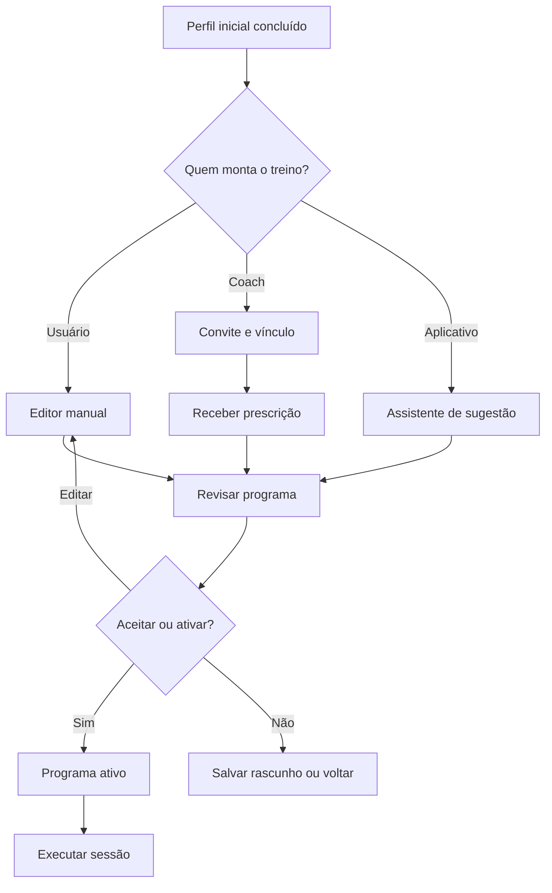
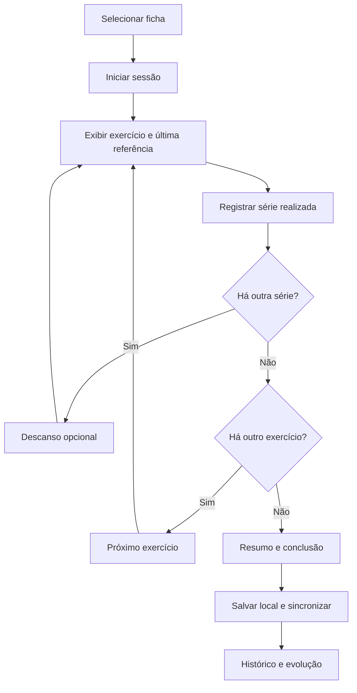
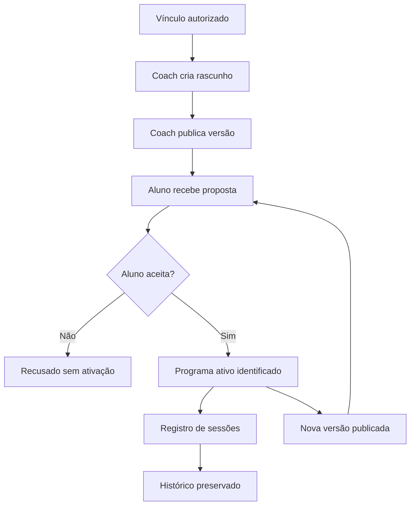

# CapiFit — Documento 02
## Personas, Jornadas de Usuário e Fluxos de Navegação

**Projeto:** CapiFit (nome provisório)  
**Versão:** 1.0 — Especificação de experiência  
**Data:** 21/10/2026  
**Status:** Proposta para validação — revisão 1.1 (21/10/2026) reconciliada pelo Documento 06, que prevalece em caso de divergência  
**Documento anterior:** `01_visao_geral_especificacao_funcional.md`  
**Próxima especificação sugerida:** Documento 03 — Arquitetura de Informação, Telas e Componentes de Interface

---

## 1. Objetivo e escopo

Descrever **quem usa** o CapiFit, **o que pretende alcançar**, **quais passos realiza** e **como navega** entre telas. Os fluxos aqui definidos operacionalizam os requisitos do Documento 01 sem substituir a especificação de banco de dados ou as decisões finais de UI.

Princípios que permanecem obrigatórios:

1. Uma estrutura compartilhada para treinos criados pelo **praticante**, pelo **coach** ou **sugeridos pelo app**.
2. O usuário consegue executar e registrar exercícios com o mínimo de interações possível.
3. Os programas, as versões e as sessões realizadas devem permanecer distintos.
4. A origem e a responsabilidade por cada treino são visíveis.
5. O usuário mantém seu histórico ao alterar a origem do treino ou desvincular um coach.
6. A Capi é uma assistente visual opcional, jamais um obstáculo ao treino.
7. Dados potencialmente sensíveis são protegidos com controle de acesso, minimização e consentimento adequado.

**Convenções:** `[MVP]` significa previsto para a primeira entrega; `[P2]` para uma fase posterior; `[DECISÃO]` indica item ainda não fechado. Os identificadores `FL-`, `TEL-` e `AC-` deverão ser preservados na rastreabilidade do projeto.

---

## 2. Perfis e atores do sistema

| Ator | Definição | Ações principais | Contexto |
|---|---|---|---|
| Praticante autônomo | Pessoa que gerencia seus próprios treinos | Montar, importar sugestão, executar, registrar e acompanhar histórico | Mobile |
| Aluno com coach | Praticante que aceita vínculo com profissional | Receber e aceitar prescrições, executar e compartilhar dados autorizados | Mobile |
| Coach / profissional | Responsável por elaborar e acompanhar programas de alunos | Convidar/vincular, prescrever, versionar, acompanhar adesão | Portal web responsivo [P2]; funcionalidades mínimas de vínculo/prescrição devem existir quando lançadas |
| Administrador | Responsável pela operação e governança | Gerenciar contas, permissões, biblioteca e publicações | Portal web |
| Curador técnico | Papel administrativo com foco no catálogo | Revisar técnicas, instruções, mídias e demonstrações | Portal web |
| Motor de sugestão | Serviço automatizado, não um usuário | Propor programas a partir dos dados informados e das regras aprovadas | Backend |

**Nota regulatória:** o cadastro de “coach” não implica automaticamente habilitação profissional. Os recursos de prescrição para terceiros exigirão verificação e políticas compatíveis com as regras aplicáveis.

---

## 3. Personas de referência (hipóteses de produto)

Estas personas são **fictícias**, usadas para orientar decisões e testes de usabilidade; não são resultados de entrevistas realizadas.

### P01 — Lucas, iniciante autônomo

- **Contexto:** 26 anos, começa a musculação, possui 3 dias por semana de 45 minutos.
- **Objetivo:** conseguir uma rotina simples que possa executar sem depender de explicações externas.
- **Dores:** nomes desconhecidos, excesso de opções, dúvidas de execução.
- **Motivação:** ver o que fazer hoje e registrar pequenas melhorias.
- **Necessidades:** onboarding curto, sugestão revisável, demonstrações objetivas e troca de equipamentos.
- **Critério de sucesso:** consegue ativar um treino adequado ao seu perfil declarado e registrar uma sessão sem assistência.

### P02 — Mariana, praticante intermediária

- **Contexto:** 32 anos, treina 5 vezes por semana e gosta de personalizar suas divisões.
- **Objetivo:** acompanhar cargas, repetições, evolução e consistência.
- **Dores:** planilhas difíceis de atualizar e perda de histórico ao trocar fichas.
- **Motivação:** visualizar progresso sem precisar de muitos toques.
- **Necessidades:** editor completo, duplicação de programas, histórico por exercício, descanso e offline.
- **Critério de sucesso:** consegue editar uma ficha e continuar consultando seus registros antigos.

### P03 — Rafael, aluno acompanhado

- **Contexto:** 39 anos, treina com orientação profissional, mas às vezes precisa substituir equipamentos.
- **Objetivo:** receber uma prescrição clara e registrar fielmente o treino.
- **Dores:** confusão entre ficha oficial e adaptações feitas no dia.
- **Motivação:** compartilhar com o profissional o que efetivamente realizou.
- **Necessidades:** vínculo consentido, origem e versão explícitas, substituições sinalizadas e visibilidade do histórico.
- **Critério de sucesso:** aceita novo plano, executa e compartilha somente dados autorizados.

### P04 — Camila, profissional de Educação Física

- **Contexto:** 35 anos, acompanha diversos alunos com disponibilidade e objetivos diferentes.
- **Objetivo:** prescrever com agilidade, atualizar versões e compreender adesão.
- **Dores:** fichas dispersas em mensagens e falta de retorno estruturado.
- **Motivação:** reduzir trabalho operacional sem perder autonomia técnica.
- **Necessidades:** modelos reutilizáveis, vínculo validado, status de aceite, registros de treino e filtros de acompanhamento.
- **Critério de sucesso:** publica uma nova versão sem apagar a anterior e identifica quais alunos a aceitaram.

### P05 — Administrador / curador

- **Contexto:** mantém a qualidade e a segurança da plataforma.
- **Objetivo:** publicar um catálogo confiável e rastrear mudanças.
- **Dores:** duplicidade de exercícios, animações imprecisas e permissões excessivas.
- **Necessidades:** estados de revisão, trilha de auditoria e papéis segregados.
- **Critério de sucesso:** uma mídia só aparece publicamente após validação e publicação.

---

## 4. Mapa das necessidades por etapa

| Etapa | Pergunta do usuário | Resposta da interface | Papel da Capi |
|---|---|---|---|
| Descoberta | Para que serve? | Apresentação objetiva das três origens | Apresenta o conceito |
| Cadastro | O que preciso informar? | Cadastro com dados mínimos | Acolhe sem infantilizar |
| Perfil | Como o app entende meu treino? | Objetivo, nível, agenda, equipamentos, restrições | Explica por que cada dado é útil |
| Seleção | Quem vai montar? | Eu / Meu coach / O app sugere | Diferencia os modos |
| Planejamento | O que farei na semana? | Prévia de programas, dias e exercícios | Ensina termos e demonstra |
| Execução | Qual é a próxima série? | Tela de exercício, carga, reps e descanso | Demonstra quando solicitado |
| Conclusão | Como fui hoje? | Resumo objetivo de sessão | Parabeniza sem cobranças |
| Evolução | Estou melhorando? | Histórico, frequência, cargas e volume | Traduz indicadores simples |
| Troca de programa | Perderei meu histórico? | Versionamento claro e arquivamento | Explica a continuidade |

---

## 5. Arquitetura de navegação proposta

### 5.1 Aplicativo do praticante — navegação principal [MVP]

Barra inferior com **quatro áreas**:

1. **Início** (`TEL-010`): treino sugerido para hoje, botão iniciar, próximo treino, atividade recente.
2. **Treinos** (`TEL-020`): programas ativos, fichas, criação, edição e origem das rotinas.
3. **Evolução** (`TEL-030`): histórico de sessões, cargas e indicadores básicos.
4. **Perfil** (`TEL-040`): informações, preferências, privacidade, vínculo com coach e configurações.

**Fluxo central destacado:** Início → Ficha do dia → Executar → Resumo → Início/Evolução.

A biblioteca de exercícios (`TEL-024`) será acessada em contexto pelo editor de treinos, e não ocupará uma quinta aba no MVP.

### 5.2 Experiência do coach [P2]

Portal responsivo com: **Visão geral**, **Alunos**, **Programas**, **Modelos**, **Acompanhamento**, **Conta**. Não é necessário reproduzir toda a interface do praticante no painel profissional.

### 5.3 Experiência administrativa [MVP operacional]

Painel web: **Dashboard operacional**, **Catálogo**, **Mídias/animações**, **Revisões**, **Usuários/papéis**, **Auditoria**, **Configurações**. Permissões segmentadas por papel.

---

## 6. Inventário de telas do aplicativo

| ID | Tela | Objetivo | Prioridade |
|---|---|---|---|
| TEL-001 | Splash e inicialização | Validar sessão e estado local | MVP |
| TEL-002 | Boas-vindas | Explicar valor e oferecer login/cadastro | MVP |
| TEL-003 | Cadastro e login | Criar/autenticar conta | MVP |
| TEL-004 | Recuperação de acesso | Restabelecer acesso | MVP |
| TEL-005 | Onboarding de perfil | Objetivo, experiência, agenda e equipamentos | MVP |
| TEL-006 | Preferências e limitações | Informações úteis e alertas de segurança | MVP |
| TEL-007 | Escolha da origem do treino | Manual, coach ou sugestão | MVP |
| TEL-010 | Início | Acesso ao treino atual | MVP |
| TEL-011 | Detalhe da ficha | Conferir exercícios e iniciar | MVP |
| TEL-012 | Execução — exercício | Registrar séries/carga/repetições | MVP |
| TEL-013 | Descanso | Timer não bloqueante | MVP |
| TEL-014 | Resumo da sessão | Salvar resultado e consultar desempenho | MVP |
| TEL-020 | Meus treinos | Listar programas e estados | MVP |
| TEL-021 | Criar/editar programa | Nome, origem, divisão e organização | MVP |
| TEL-022 | Editar ficha | Ordenar exercícios e definir parâmetros | MVP |
| TEL-023 | Configurar exercício | Séries, repetições, descanso, observações | MVP |
| TEL-024 | Biblioteca/busca de exercícios | Filtrar e selecionar exercícios | MVP |
| TEL-025 | Detalhe de exercício | Demonstração e instruções revisadas | MVP (conteúdo essencial) |
| TEL-026 | Assistente de sugestão | Coletar dados para propor programa | MVP |
| TEL-027 | Revisar sugestão | Explicar, editar, aceitar ou descartar | MVP |
| TEL-028 | Solicitações do coach | Receber, aceitar e recusar programa | MVP se prescrição por coach estiver ativa |
| TEL-030 | Evolução | Indicadores e links para sessões | MVP (básico) |
| TEL-031 | Histórico de treinos | Consultar sessões anteriores | MVP |
| TEL-032 | Histórico de exercício | Comparar registros por exercício | P2 |
| TEL-040 | Perfil e configurações | Dados, notificações e acessibilidade | MVP |
| TEL-041 | Vínculos profissionais | Autorizar/revogar coach e escopo de dados | MVP se vínculo estiver ativo |
| TEL-042 | Privacidade e exportação | Transparência, solicitação de cópia/exclusão | MVP (fluxo mínimo) |
| TEL-050 | Estados de erro/offline | Recuperação, conflitos e sincronização | MVP |

**Convenção:** a classificação “MVP se ... estiver ativo” reconhece o lançamento em fases: o núcleo do modelo híbrido deve ser planejado desde já, mas o lançamento profissional pode ser liberado após o núcleo individual, como estabelecido no Documento 01.

---

## 7. Fluxos detalhados do praticante

### FL-01 — Primeiro acesso e perfil [MVP]

**Entrada:** aplicativo instalado e usuário sem sessão ativa.  
**Caminho feliz:**

1. Abrir `TEL-002`, selecionar criar conta.
2. Informar credenciais em `TEL-003` e concluir validações necessárias.
3. Entrar em `TEL-005`; informar objetivo, nível e dias disponíveis.
4. Informar duração preferida e equipamentos acessíveis.
5. Em `TEL-006`, declarar restrições relevantes opcionalmente; explicitar uso dos dados.
6. Mostrar `TEL-007` e escolher origem do primeiro treino.
7. Prosseguir ao fluxo `FL-02`, `FL-03` ou `FL-04`.

**Exceções:** e-mail já cadastrado → login/recuperação; interrupção → retomar dados salvos localmente quando seguro; dados insuficientes para sugestão → coleta adicional ou criação manual. Não exigir dados pessoais desnecessários para o cadastro.

**Aceite:** usuário chega à escolha de origem sem inserir medidas corporais obrigatórias.

### FL-02 — Criar treino manualmente [MVP]

**Entrada:** `TEL-007` ou `TEL-020`.  
**Caminho feliz:** `TEL-021` → nomear programa → adicionar ficha em `TEL-022` → pesquisar exercícios em `TEL-024` → definir séries/repetições/descanso em `TEL-023` → ordenar → revisar → salvar rascunho ou ativar.

**Regras:** fichas podem ter nomes livres; validação de pelo menos um exercício antes de ativar; carga inicial é opcional; edição de programa ativo cria uma nova versão lógica quando altera a prescrição, sem mutar sessões anteriores. Uma ficha pode ser executada fora do dia sugerido.

**Exceções:** sair sem salvar → confirmar descarte ou manter rascunho; exercício indisponível → alternativa existente no catálogo; sem conexão → o editor mantém **rascunho local** (não sincronizado) e avisa que salvar/publicar exige conexão; o sync offline do MVP cobre apenas a execução de treino (Documento 06, D-03).

### FL-03 — Receber treino do coach [Fase de vínculo]

**Pré-condição:** vínculo autorizado com profissional apto, segundo política da plataforma.  
**Caminho feliz:** `TEL-041` → aceitar convite de vínculo → `TEL-028` recebe programa publicado → abrir prévia com autor/versão/data → aceitar → programa passa a ser selecionável em `TEL-020` → executar normalmente.

**Regras:** o aceite é um registro explícito (`aceites_programa`, Documento 06 §6); **aceitar não ativa** o programa — a ativação é ação separada; rascunhos do coach nunca são visíveis ao aluno; recusar é permitido; versões novas não substituem silenciosamente a ativa; ao editar prescrição do coach, criar **cópia pessoal** identificada ou ajuste de execução registrado, sem modificar a original; revogar vínculo interrompe novo compartilhamento; sessões históricas continuam pertencendo ao praticante.

**Exceções:** convite expirado, coach sem permissão, programa retirado, vínculo revogado durante aceite → não ativar e orientar usuário.

### FL-04 — Gerar sugestão de treino [MVP com motor de regras]

**Entrada:** `TEL-007` ou `TEL-020`.  
**Caminho feliz:** `TEL-026` coleta objetivo, experiência, disponibilidade, equipamentos e preferências → motor avalia elegibilidade → gera uma proposta → `TEL-027` apresenta divisão, exercícios, justificativa simples e indicação explícita “Sugerido pelo aplicativo” → usuário edita ou aceita → grava programa com origem `app`, versão e dados de regras → ativa.

**Regras:** nunca apresentar uma sugestão como prescrição feita por profissional; esclarecer limitações; permitir recusa sem penalidade; registrar versão do conjunto de regras utilizado; não recomendar sobrecarga automática sem revisão. Restrições declaradas que afetem segurança podem limitar sugestões e orientar avaliação profissional.

**Exceções:** dados incompatíveis ou insuficientes → solicitação pontual de informações ou bloqueio fundamentado da sugestão; indisponibilidade do motor → criação manual.

### FL-05 — Executar uma sessão [MVP — jornada crítica]

**Entrada:** `TEL-010`, `TEL-011` ou `TEL-020`.  
**Caminho feliz:** selecionar ficha → iniciar `TEL-012` → carregar prescrição e último registro do exercício (quando existente) → informar/ajustar carga e repetições → marcar série como feita → oferecer `TEL-013` (descanso opcional) → próxima série ou exercício → encerrar → `TEL-014` apresenta duração, exercícios, séries e observações → concluir.

**Regras:** campos de carga/repetições vêm **pré-preenchidos e editáveis** (meta ou último registro) e só viram registro quando o usuário conclui a série; é possível **substituir ou adicionar exercício** durante a sessão, **pausar/retomar** e iniciar um **treino avulso** sem ficha; diferenciação visível entre **previsto** e **realizado**; unidades consistentes (kg, repetições, segundos); guardar alterações por série; descanso não impede registrar outra série; impedir duplicação acidental de conclusão; sessão pode ser pausada/retomada; operação offline com sincronização posterior.

**Exceções:** abandono → oferecer pausar, descartar ou finalizar parcial; app fechado → recuperar sessão em andamento; exercício pulado → registrar como não realizado; conflitos de sincronização → nunca descartar silenciosamente registros de execução.

**Aceite:** realizar a próxima série exige poucos toques; cada registro fica associado à sessão, ao exercício e à versão do programa adotada.

### FL-06 — Consultar evolução [MVP básico]

**Entrada:** `TEL-030`.  
**Caminho feliz:** escolher intervalo → visualizar sessões concluídas, frequência e volumes básicos calculados → acessar `TEL-031` → abrir detalhe da sessão. Na etapa posterior, filtrar por exercício e mostrar tendências (`TEL-032`).

**Estados:** sem sessões → incentivar iniciar treino; dados parciais → explicar cálculo; registros editados → mostrar informação atual e manter trilha de auditoria quando aplicável.

### FL-07 — Trocar programa ou origem [MVP]

**Entrada:** `TEL-020`.  
**Caminho feliz:** visualizar programa ativo e sua origem → escolher outro existente ou iniciar nova criação/sugestão → visualizar impactos → confirmar ativação → versão anterior é preservada e pode ser arquivada.

**Regras:** programa substituído não apaga histórico, e o sistema não atribui ao coach um programa alterado pelo aluno.

### FL-08 — Gerenciar vínculo e privacidade [Fase de vínculo]

**Entrada:** `TEL-041` / `TEL-042`.  
**Caminho feliz:** revisar profissional, categorias de dados acessíveis e finalidade → consentir/autorizar → consultar vínculos ativos → revogar acesso e receber confirmação. Exibir meios de solicitar exportação e eliminação observadas obrigações legais.

**Regras:** vínculo não autoriza acesso irrestrito aos dados; autorização é específica; revogação não altera registros de sessões do aluno.

---

## 8. Fluxos do coach

### FL-09 — Convidar e vincular aluno [P2]

1. Coach autenticado solicita vínculo por convite/código seguro.
2. Aluno recebe convite e identifica nome do profissional e escopo do compartilhamento.
3. Aluno aceita ou recusa; o sistema registra data, versão dos termos e permissões.
4. Coach passa a visualizar somente os dados autorizados.

**Estados do vínculo:** pendente, ativo, recusado, expirado, revogado, suspenso.

### FL-10 — Prescrever e publicar programa [P2]

1. Selecionar aluno vinculado.
2. Criar programa do zero ou duplicar modelo próprio.
3. Definir fichas, exercícios, séries e parâmetros.
4. Salvar como rascunho e revisar.
5. Publicar uma versão identificada; aluno recebe aviso.
6. Acompanhar aceite, execução e evolução dentro do escopo autorizado.

**Estados do programa:** rascunho, publicado/pendente de aceite, aceito/ativo, recusado, substituído, arquivado. A nova publicação nunca altera silenciosamente uma versão previamente aceita.

### FL-11 — Acompanhar aluno [P2]

Abrir ficha do aluno → verificar adesão/sessões e últimas versões aceitas → consultar execução e observações autorizadas → ajustar novo programa quando necessário. Não expor dados de outros alunos no mesmo contexto.

---

## 9. Fluxos administrativos

### FL-12 — Publicar exercício e demonstração [MVP operacional]

1. Curador cadastra exercício e variações com nomenclatura padronizada.
2. Associa grupos musculares, equipamentos, instruções e cuidados.
3. Envia mídia da Capi ou material complementar.
4. Revisor habilitado avalia correção técnica da execução e direitos de uso.
5. Publica exercício/mídia; aplicativo recebe versão aprovada.

**Estados:** rascunho → em revisão → aprovado → publicado; rejeitado exige justificativa. Mudanças críticas criam revisão e não substituem mídia aprovada sem processo definido.

### FL-13 — Gerenciar incidentes e acessos [MVP operacional]

Administrador pesquisa evento de auditoria, identifica recurso e ação, restringe permissões segundo necessidade e documenta intervenção. Logs não devem conter credenciais ou dados sensíveis além do estritamente necessário.

---

## 10. Diagramas de fluxo (Mermaid)

### 10.1 Escolha da origem de treino

### 10.2 Sessão de treino

### 10.3 Prescrição por coach e versionamento

---

## 11. Contratos de UX e estados transversais

### 11.1 Estados de interface

Toda tela com dados assíncronos terá: carregando, vazio, sucesso, erro recuperável, acesso negado e operação offline quando aplicável. Mensagens devem informar **o que aconteceu**, **se os dados foram preservados** e **qual ação é possível**.

### 11.2 Offline e sincronização

- Dados necessários para o treino do dia devem poder estar disponíveis localmente.
- Cada sessão e série registrada precisa de identificadores únicos para sincronização idempotente.
- Os registros são mantidos localmente até confirmação do servidor.
- Conflitos devem ser visíveis e resolvidos sem exclusão silenciosa; a estratégia está definida no Documento 06 §7 (última-escrita-vence por série, conflito explícito entre dispositivos, UUIDs gerados pelo cliente).
- **Escopo offline do MVP:** execução de treino. Edição estrutural de programa exige conexão.

### 11.3 Acessibilidade

- Suporte a tamanho de texto ampliado, contraste apropriado e alvos de toque confortáveis.
- Informações não dependem exclusivamente de cores, som ou da Capi.
- Respeitar preferência de movimento reduzido; animações demonstrativas devem oferecer controles.
- Uso principal deve ser possível sem áudio e com conexão limitada.

### 11.4 Notificações

Notificações são opcionais e configuráveis. Evitar mensagens culpabilizadoras por ausência. Em fases posteriores, contemplar lembretes de treino e atualizações de coach mediante escolha do usuário.

---

## 12. Sistema de interação da Capi

### 12.1 Papéis e pontos de aparição

| Contexto | Comportamento | Padrão |
|---|---|---|
| Boas-vindas | Apresentação breve | Aparece na primeira visita |
| Onboarding | Explica campos e termos quando útil | Não bloqueia navegação |
| Editor | Oferece ajuda contextual | Discreta / sob demanda |
| Detalhe do exercício | Demonstra movimento em mídia aprovada | Acionada pelo usuário |
| Execução de séries | Não cobre campos críticos | Oculta durante registro |
| Fim da sessão | Reforço positivo sem comparação de corpos | Curta e desativável |
| Evolução | Explica indicadores com linguagem simples | Contextual / opt-in |
| Erros | Não faz piadas com falhas ou dados pessoais | Neutra e objetiva |

### 12.2 Diretrizes visuais e funcionais

A Capi deve ter identidade consistente de rosto, anatomia estilizada, roupas e paleta. A versão para demonstrar movimentos precisa priorizar legibilidade biomecânica; sempre que as proporções da personagem não permitirem demonstrar técnica com fidelidade, complementar com referência humana/diagramática validada. Vídeos/animações recebem estados de curadoria e versões. Não pressupor que a personagem por si só garanta correção técnica.

**Configurações previstas:** ativar/desativar comentários, reduzir animações, silenciar áudios e reproduzir demonstrações somente sob solicitação.

### 12.3 Exemplos de microtexto

- Primeiro acesso: “Oi! Eu sou a Capi. Vamos organizar seu treino?”
- Sugestão pronta: “Preparei uma proposta para você revisar. Dá para mudar tudo antes de começar.”
- Durante execução: “Quer conferir o movimento? Abra a demonstração.”
- Sessão concluída: “Treino registrado! Seu histórico está atualizado.”
- Sem treino registrado: “Quando quiser voltar, seu treino estará aqui.”

---

## 13. Cenários críticos e decisões de negócio

| Cenário | Comportamento esperado |
|---|---|
| Aluno tem ficha própria e ficha do coach | Ambas podem existir; apenas um programa de referência ativo por contexto definido; origem sempre visível |
| Coach publica versão nova com treino em andamento | Sessão em andamento continua vinculada à versão com que começou; atualização aguarda escolha/aceite |
| Usuário troca exercício durante sessão | Registrar substituição feita, preservar prescrição original e identificar exercício efetivamente executado |
| Usuário perde conexão | Treino e registros continuam no dispositivo; status de sincronização visível |
| App reinicia durante sessão | Recuperar rascunho da sessão, evitando duplicação |
| Coach perde vínculo | Deixa de acessar novos dados e deixa de publicar para aquele aluno; histórico do praticante permanece |
| Suggestão automática é inadequada aos dados declarados | Não apresentar proposta definitiva; explicar limitação e oferecer alternativa segura |
| Mídia da Capi é removida para revisão | Mostrar conteúdo textual aprovado/alternativo, sem interromper o registro |
| Usuário altera programa com sessões anteriores | Criar versão e preservar associação das sessões às versões originais |

---

## 14. Critérios de aceitação verificáveis

- **AC-01:** novo usuário percorre cadastro, perfil e escolha de origem sem informar medidas corporais obrigatórias.
- **AC-02:** o modo manual permite criar, editar e ativar uma ficha com exercício e pelo menos uma série.
- **AC-03:** uma proposta automática exibe origem, premissas e opção de editar/descartar antes de ativar.
- **AC-04:** uma prescrição profissional exibe autor e versão e depende de vínculo válido e aceite explícito.
- **AC-05:** ao executar, o usuário visualiza prescrição e registra carga/repetições efetivas separadamente.
- **AC-06:** fechar e reabrir o app não apaga uma sessão em andamento já persistida localmente.
- **AC-07:** editar ficha ou ativar outra não altera sessões concluídas.
- **AC-08:** uma sessão offline pode ser sincronizada sem duplicar séries ou conclusão.
- **AC-09:** usuário com a Capi desabilitada realiza todas as tarefas essenciais.
- **AC-10:** animação de exercício só é exibida como instrução após revisão e publicação.
- **AC-11:** aluno pode recusar programa do coach sem perder programas anteriores.
- **AC-12:** revogação de vínculo impede novas consultas não autorizadas pelo profissional.
- **AC-13:** telas apresentam mensagens úteis para estados vazios, erros e sincronização pendente.
- **AC-14:** fluxos essenciais funcionam com acessibilidade de texto ampliado e sem som.

---

## 15. Priorização de UX por entrega

**MVP — núcleo individual com arquitetura híbrida preparada:** `FL-01`, `FL-02`, `FL-04`, `FL-05`, `FL-06` (básico), `FL-07`, `FL-12` (catálogo), `FL-13`; telas de onboarding, editor, biblioteca, execução, histórico, perfil e erro/offline.

**Ampliação profissional (Fase 3 do MVP, ponta a ponta):** `FL-03`, `FL-08`, `FL-09`, `FL-10`, `FL-11`, com vínculo, prescrição, aceite, painel e permissões. O fluxo conceitual está definido neste documento; modelo e API já existem desde a Fase 1 (Documento 06). `FL-04` (sugestão) é entregue na Fase 2, antes do coach.

**Evolução posterior:** gráficos detalhados por exercício, regras avançadas de progressão, mensagens mais contextuais da Capi, gamificação, integração com dispositivos, recursos comerciais e inteligência assistiva avançada.

**Critério para antecipar módulo:** se o primeiro piloto comercial depender de personal trainers, mover para o MVP todo o percurso de vínculo → prescrição → aceite → execução → acompanhamento, de ponta a ponta; não lançar apenas uma tela incompleta de coach.

---

## 16. Roteiro de validação com usuários

Realizar testes de navegação com participantes que representem iniciantes, experientes e alunos acompanhados. Roteiros mínimos:

1. Criar um treino manual com 2 exercícios.
2. Gerar uma sugestão para 3 dias e substituir um exercício.
3. Registrar três séries, pausar e retomar o treino.
4. Localizar o peso realizado no treino anterior.
5. Receber uma atualização do coach e identificar o autor da versão.
6. Usar a demonstração da Capi e repetir a tarefa com a personagem desabilitada.
7. Executar uma sessão simulando perda de internet.

Observar taxa de conclusão, tempo e pontos de confusão. As metas numéricas de UX serão definidas após protótipo testável e linha de base real, evitando promessas arbitrárias.

---

## 17. Pendências para decisão

1. **Estratégia de lançamento:** piloto inicialmente individual ou já com profissionais convidados?
2. **Programa ativo:** um programa ativo global ou vários ativos em paralelo com escolha explícita?
3. **Edição de treinos do coach:** somente cópia pessoal ou ajustes locais registrados sem alterar prescrição?
4. **Identidade de profissional:** documentação, verificação e regras de habilitação.
5. **Demonstrações:** vídeo renderizado no MVP versus animação 3D interativa posterior.
6. **Catálogo inicial:** quantidade, critérios de cobertura e responsáveis pela curadoria.
7. **Sugestão inicial:** regras permitidas, bloqueios de segurança e revisão especializada.
8. **Indicadores de evolução:** conjunto mínimo a expor sem interpretações enganosas.

---

## 18. Definição de pronto e próximo documento

Este documento estará validado quando o time concordar sobre: personas prioritárias, a navegação principal, os três fluxos de origem, o fluxo crítico de execução, estados de erro, regras de vínculo, atuação da Capi e cortes de escopo.

**Documento 03 proposto — Arquitetura de Informação, Telas e Componentes de Interface:** sitemap definitivo, wireframes por tela, componentes reutilizáveis, estados de interface, padrões de interação e diretrizes visuais da CapiFit. O modelo de dados e a API devem então ser detalhados em documentos técnicos específicos, rastreados pelos IDs `TEL-`, `FL-` e `AC-`.

---

**Fim do Documento 02 — CapiFit**
