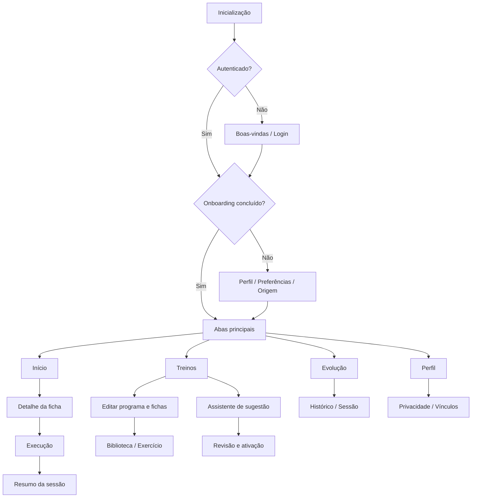

# CapiFit — Documento 03
## Arquitetura da Informação, Telas e Componentes de Interface

**Versão:** 1.0 — baseline para UX/UI e desenvolvimento  
**Data:** 21/10/2026  
**Status:** Proposta para validação — revisão 1.1 (21/10/2026) reconciliada pelo Documento 06, que prevalece em caso de divergência  
**Projeto:** CapiFit — aplicativo híbrido de treinamento de musculação  
**Dependências:** Documento 01 — Visão Geral do Produto e Especificação Funcional; Documento 02 — Personas, Jornadas e Fluxos de Navegação

---

## 1. Objetivo e limites

Definir a organização da experiência do CapiFit, transformando as jornadas do Documento 02 em especificações de navegação, telas, componentes e comportamentos verificáveis. Este documento **não** é um layout visual definitivo, um contrato de API nem uma prescrição de exercícios. Contém wireframes textuais, tokens propostos, requisitos de acessibilidade e decisões de interface para Android, iOS e painéis web.

**Premissas fundamentais:** (i) o praticante pode montar o programa, receber prescrição de coach ou aceitar sugestão do app; (ii) todas as origens desembocam no mesmo executor e histórico; (iii) programas têm versões e histórico imutável de sessões; (iv) a Capi ajuda, mas não interrompe o registro; (v) treinar offline deve continuar possível após os dados essenciais estarem disponíveis localmente.

**Legenda de entregas:** `MVP` = primeira entrega; `MVP-C` = condicional à ativação da integração com coach; `P2` = fase posterior. Telas podem ser projetadas desde já sem serem liberadas na primeira publicação.

---

## 2. Princípios de UX

1. **Treino primeiro:** na academia, nenhuma tarefa crítica deve depender de animação ou texto longo.
2. **Poucos toques:** iniciar treino em até dois toques a partir do início quando há programa ativo; concluir uma série com uma ação.
3. **Origem evidente:** mostrar sempre se o programa é **Meu**, **Do coach** ou **Sugerido pelo CapiFit**, bem como seu estado.
4. **Autonomia com rastreabilidade:** sugestões são revisáveis; programas do coach preservam original e versão; editar nunca altera o histórico de execução.
5. **Persistência contínua:** evitar perda de sessão se app for fechado ou ficar sem internet.
6. **Acessibilidade:** tipografia legível, contraste adequado, controles generosos, suporte a leitor de tela, movimento reduzido.
7. **Capi contextual:** incentivo opcional; demonstrações revisadas; nunca encobrir carga/repetições, confirmação, erro ou autorização.
8. **Transparência:** diferenciar conteúdo educativo de recomendação automática e de prescrição profissional.

---

## 3. Arquitetura da informação — aplicativo do praticante

### 3.1 Navegação primária

Quatro abas fixas, alinhadas ao Documento 02:

| Aba | Rota conceitual | Conteúdo | Ação principal |
|---|---|---|---|
| **Início** | `/home` | Próximo treino, estado do programa, atividade recente, mensagem contextual da Capi | Iniciar treino |
| **Treinos** | `/workouts` | Programas, fichas, origem, versões, criação e edição | Criar / abrir programa |
| **Evolução** | `/progress` | Histórico, frequência, carga/volume básico | Abrir sessão |
| **Perfil** | `/profile` | Conta, preferências, privacidade, vínculos profissionais | Editar preferências |

**Navegação secundária:** telas de edição e execução em stack; exercícios em busca/picker modal ou tela cheia conforme espaço; confirmação destrutiva em diálogo; exercício atual em tela focada. O timer não substitui nem bloqueia o executor.

**Regra de prioridade:** durante uma sessão ativa, exibir indicação persistente de **Voltar ao treino** nas abas acessíveis; nunca iniciar uma segunda sessão simultânea por acidente. A sessão poderá ser retomada após reinicialização.

### 3.2 Sitemap mobile



### 3.3 Critérios de exibição

- **Sem programa ativo:** Início exibe ação `Criar meu treino` e alternativas `Receber do coach` (quando habilitado) e `Receber sugestão`.
- **Programa ativo:** mostrar próxima ficha, origem e última sessão sem forçar uma ordem rígida de dias.
- **Programa pendente do coach:** badge `Aguardando sua aprovação`, ações `Visualizar`, `Aceitar`, `Recusar`.
- **Vários programas:** apenas um programa principal por vez no dashboard; os demais ficam disponíveis com estados `rascunho`, `ativo`, `arquivado`, `pendente`.
- **Sessão em andamento:** CTA prioritário `Continuar treino` antes de `Iniciar novo`.
- **Sem conexão:** indicar `Offline — alterações salvas neste dispositivo` e fila de sincronização.
- **Treino avulso:** além de `Iniciar treino`, oferecer `Treino avulso` (sessão sem ficha, exercícios adicionados do catálogo); disponível também sem programa ativo.

---

## 4. Inventário de telas com IDs estáveis

Os identificadores são herdados do Documento 02, evitando renumeração que quebre referências posteriores.

| ID | Tela | Prioridade | Layout / comportamento principal |
|---|---|---|---|
| TEL-001 | Inicialização | MVP | Splash breve, checagem local e restauração de sessão |
| TEL-002 | Boas-vindas | MVP | Proposta de valor, entrar/cadastrar |
| TEL-003 | Login e cadastro | MVP | E-mail, senha, validações, consentimentos necessários |
| TEL-004 | Recuperação | MVP | Solicitar redefinição e feedback sem enumeração de contas |
| TEL-005 | Perfil inicial | MVP | Objetivo, experiência, dias, tempo, equipamentos |
| TEL-006 | Preferências/limitações | MVP | Informações opcionais e sinalização de cuidado |
| TEL-007 | Escolher origem | MVP | Manual / coach / app, com estados de disponibilidade |
| TEL-010 | Início | MVP | Próxima ficha e resumo rápido |
| TEL-011 | Detalhe da ficha | MVP | Exercícios, metadados e iniciar/continuar |
| TEL-012 | Execução | MVP | Série, carga, reps, concluir, navegar exercício |
| TEL-013 | Descanso | MVP | Contagem não bloqueante, pausar/pular |
| TEL-014 | Resumo | MVP | Sessão concluída, registros e voltar |
| TEL-020 | Meus treinos | MVP | Lista agrupada por estado / origem |
| TEL-021 | Programa — criar/editar | MVP | Nome, estrutura, ordem das fichas |
| TEL-022 | Ficha — editar | MVP | Sequência de exercícios, duplicar, reordenar |
| TEL-023 | Configurar exercício | MVP | Séries, reps, descanso e instruções opcionais |
| TEL-024 | Biblioteca de exercícios | MVP | Busca, filtro, seleção, ausência de resultados |
| TEL-025 | Detalhe do exercício | MVP | Demonstração, execução, cautelas e alternativas |
| TEL-026 | Assistente de sugestão | MVP | Questionário curto, confirmação de dados |
| TEL-027 | Revisar sugestão | MVP | Racional resumido, ajustes e ativação |
| TEL-028 | Prescrição recebida | MVP-C | Prévia, coach, versão, aceite/recusa |
| TEL-030 | Evolução | MVP básico | Resumo de sessões e indicadores simples |
| TEL-031 | Histórico | MVP | Lista cronológica e detalhe de sessão |
| TEL-032 | Evolução por exercício | P2 | Tendência de desempenho por exercício |
| TEL-040 | Perfil | MVP | Conta, preferências, notificações |
| TEL-041 | Vínculos com coaches | MVP-C | Escopos, revogação, convites |
| TEL-042 | Privacidade/dados | MVP | Política, exportação/exclusão e estados de solicitação |
| TEL-050 | Offline e erros | MVP | Banners, reconciliação, erros recuperáveis |

---

## 5. Wireframes funcionais textuais

Os desenhos abaixo descrevem **hierarquia e comportamento**, não pixels finais.

### 5.1 TEL-010 — Início (programa ativo)

```text
┌────────────────────────────────────┐
│ CapiFit           [sincronizado] ⚙ │
│ Olá! Bora treinar?                 │
│ [Capi compacta / mensagem opcional]│
├────────────────────────────────────┤
│ PROGRAMA ATIVO  [Meu / Coach / App]│
│ Treino A — Peito e Tríceps         │
│ 6 exercícios · ~55 min            │
│ [ INICIAR / CONTINUAR TREINO ]     │
├────────────────────────────────────┤
│ Sua semana                        │
│ [Seg] [Ter] [Qua] [Qui] ...       │
│ Última sessão: data / duração      │
├────────────────────────────────────┤
│ Início | Treinos | Evolução | Perfil│
└────────────────────────────────────┘
```

**Estados:** sem programa; convite de coach pendente; sessão em aberto; offline; falha ao carregar resumo (CTA principal ainda disponível a partir dos dados locais).

### 5.2 TEL-020 — Meus treinos

```text
┌────────────────────────────────────┐
│ Meus treinos                   [+] │
│ [Ativo] [Rascunhos] [Arquivados]   │
│ Programa Hipertrofia  [Do coach]   │
│ versão 2 · atualizado em ...       │
│ [Treino A] [Treino B] [Treino C]  │
│                              [⋮] │
│ [ Criar programa ]                 │
│ [ Receber sugestão ]               │
└────────────────────────────────────┘
```

Menu de ações considera permissão: programa criado pelo aluno pode ser editado; o do coach deve permitir `Ver prescrição`, `Solicitar alteração` (P2) ou `Criar cópia pessoal`, sem sobrescrever a autoria.

### 5.3 TEL-022/023 — Editor de ficha

```text
┌────────────────────────────────────┐
│ ‹ Treino A               [Salvar]  │
│ Nome / foco / observações          │
│ ≡ Agachamento    3x 8–12  [Editar]│
│ ≡ Leg press      3x 10–12 [Editar]│
│ ≡ Panturrilha    3x 12–15 [Editar]│
│ [ + Adicionar exercício ]          │
│ [ Pré-visualizar ficha ]           │
└────────────────────────────────────┘
```

**Campos por exercício:** exercício base, ordem, tipo de série (normal/aquecimento quando disponível), nº séries, faixa de repetições, carga-alvo opcional, descanso, observações. Exibir resumo legível e validação por campo. Edição com estado `não salvo`; alerta ao sair com mudanças pendentes.

### 5.4 TEL-012 — Executor (tela mais importante)

```text
┌────────────────────────────────────┐
│ ‹ Treino A       exercício 2 de 6 │
│ Supino reto com barra             │
│ [Demonstração Capi] [Instruções]   │
│ Última vez: 40 kg · 10/10/8       │
│ SÉRIE | CARGA | REPS | CONCLUÍDA  │
│  1       40      10      [✓]     │
│  2       40      10      [ ]     │
│  3       40       8      [ ]     │
│ [+ série]          [⋯ opções]     │
│ Descanso: 01:30 [Pausar] [Pular] │
│ [Anterior]               [Próximo]│
│ [ Finalizar treino ]              │
└────────────────────────────────────┘
```

**Detalhes obrigatórios:** controles numéricos com teclado apropriado; carga e repetições vêm **pré-preenchidas e editáveis** (meta prescrita ou último registro) e **só se tornam registro quando o usuário toca em concluir** (um toque confirma; Documento 06, D-14); `⋯ opções` inclui **substituir exercício**, **adicionar exercício** e **pausar treino**; ação `Concluir série` registra hora e dado local; não marcar como concluída sem confirmação dos campos exigidos; opção de corrigir série; gesto de swipe não pode apagar dados; salvar incrementalmente.

**Comportamento de descanso:** inicia após conclusão se habilitado; notificação/háptico opcionais; usuário pode editar outra série durante contagem. Manter sessão ao bloquear tela ou mudar de app, respeitando limites das plataformas.

### 5.5 TEL-026/027 — Sugestão e revisão

```text
┌────────────────────────────────────┐
│ Seu plano sugerido · Passo 3/3    │
│ Objetivo: hipertrofia             │
│ Experiência: intermediário        │
│ Frequência: 4 dias/semana         │
│ Equipamentos: academia completa   │
│ [Editar respostas]                │
│ [ Gerar sugestão ]                │
├────────────────────────────────────┤
│ Prévia: A/B/C/D                   │
│ Por que estes grupos e exercícios?│
│ [Ver fichas] [Editar]             │
│ [ Ativar programa ] [Descartar]   │
└────────────────────────────────────┘
```

Nunca publicar sugestão automaticamente no programa ativo. Avisar que são sugestões baseadas em regras/modelos revisados; não substituir avaliação profissional e explicitar insuficiência de dados ou condições que exijam revisão.

### 5.6 TEL-014 — Resumo da sessão

```text
┌────────────────────────────────────┐
│ Treino concluído!  [Capi celebra] │
│ Duração: 54 min                   │
│ Séries concluídas: 17 de 18       │
│ Exercícios executados: 6          │
│ Volume calculado*: ...            │
│ [Ver registros] [Voltar ao início]│
└────────────────────────────────────┘
```

`*` Se o indicador for exibido, definir cálculo e unidades de forma explícita; não equiparar volume à qualidade do treino. Conferir se a sessão foi persistida antes de exibir sucesso definitivo.

### 5.7 TEL-030/031 — Evolução e histórico

Indicadores básicos: sessões por semana, treinos concluídos, tempo total estimado/registrado, último treino. Lista cronológica com data, nome da ficha, programa/versão, duração e estado. Selecionar item abre registros completos. Gráficos por exercício ficam `P2`. Evitar métricas punitivas e rankings no MVP.

### 5.8 TEL-040/041/042 — Perfil, coach e privacidade

Seções distintas para preferências de notificação/mascote, acessibilidade, dados de treinamento, coaches autorizados, política de privacidade, solicitação de exportação e exclusão. Vínculo com coach mostra escopo de dados, data do consentimento e ação de revogar. Exclusão de conta exige confirmação e explica consequências.

---

## 6. Contratos de interação do modelo híbrido

| Origem | Identificação UI | Pode editar? | Aprovação/ativação | Como preservar autoria |
|---|---|---|---|---|
| Manual | `Criado por você` | Sim | Usuário publica | `creator` usuário; novas versões |
| Coach | `Prescrito por [nome]` | Original somente coach | Aluno aceita publicação recebida | alterações pelo aluno geram cópia ou pedido de ajuste |
| App | `Sugerido pelo CapiFit` | Sim, na revisão e após cópia/ativação | Aceite explícito | origem original + alterações registradas |

**Transições fundamentais:** `rascunho → pronto → ativo → arquivado`; `proposto pelo coach → aguardando aceite → aceito/recusado`; `sugestão → revisão → aceito/descartado`. O servidor valida permissões independentemente da interface. Ativar novo programa nunca apaga sessões anteriores.

**Concorrência:** alteração no mesmo programa em dois dispositivos exige versionamento e resolução explícita se houver conflito; registros de séries usam identificadores locais estáveis e operações idempotentes.

---

## 7. Design system inicial

### 7.1 Direção visual

Identidade **fitness premium acessível**, predominantemente dark mode, com detalhes vibrantes e personalidade da capivara. As cores abaixo são **tokens propostos**, não guia de marca definitivo. **Superadas pelo Documento 08** (tokens v0.2 em `08_design_tokens.json`, com tema claro e contraste verificado).

| Token | Valor proposto | Uso |
|---|---|---|
| `color.bg.primary` | `#0D1117` | Fundo geral |
| `color.bg.surface` | `#171D26` | Cartões e painéis |
| `color.bg.elevated` | `#222B36` | Modais/elevações |
| `color.brand.primary` | `#94F047` | CTA e destaques, com texto escuro |
| `color.brand.dark` | `#447A20` | Estados secundários |
| `color.text.primary` | `#F6F8FA` | Texto principal em dark |
| `color.text.secondary` | `#B5BECA` | Informação secundária |
| `color.feedback.error` | `#FF7777` | Erro + mensagem |
| `color.feedback.warning` | `#FFD166` | Atenção + mensagem |
| `color.feedback.success` | `#8CE5B0` | Sucesso + mensagem |
| `color.border` | `#35404D` | Separadores e contornos |

**Atenção:** validar contraste das combinações efetivamente usadas conforme WCAG 2.2 AA; nunca usar somente cor para indicar estado. Oferecer tema claro em fase posterior ou antes do lançamento se testes de acessibilidade assim indicarem.

### 7.2 Tipografia, espaçamento e dimensões

- Fonte sem serifa de alta legibilidade (por exemplo, Inter ou equivalente compatível com licenças); respeitar tamanho de fonte dinâmico do sistema.
- Escala proposta: 12/14/16/20/24/32; corpo principal preferencialmente 16 ou mais, sem texto crítico em 12.
- Sistema de espaçamentos baseado em 4: `4, 8, 12, 16, 24, 32` dp.
- Alvos de toque recomendados de **pelo menos 44 × 44 pt no iOS e 48 × 48 dp no Android**.
- Cantos: 8, 12, 16 e 24 dp; evitar bordas excessivas em controles de registro.
- Suporte a telas pequenas e texto ampliado, safe areas, teclado e orientação retrato no MVP, sem bloquear acessibilidade do sistema.

### 7.3 Componentes reutilizáveis

| Componente | Finalidade | Estados mínimos |
|---|---|---|
| `AppShell` / `BottomTabs` | Estrutura e navegação | normal, aba ativa, sessão em andamento |
| `TopBar` | Título, retorno e ações | normal, loading |
| `PrimaryButton` | Ação decisiva | normal, pressionado, desabilitado, carregando |
| `TextField` / `NumberField` | Entrada de dados | vazio, foco, válido, erro, desabilitado |
| `ExerciseCard` | Nome, grupo, equipamento | normal, selecionado, indisponível |
| `WorkoutCard` | Programa, origem, versão | rascunho, ativo, pendente, arquivado |
| `ExercisePicker` | Busca e filtro | vazio, carregando, resultados, sem resultados |
| `SetRow` | Carga, reps, série, conclusão | pendente, concluída, editando, erro |
| `RestTimer` | Tempo de descanso | rodando, pausado, terminado, desativado |
| `OriginBadge` | Manual, coach, app | três origens e rótulo acessível |
| `SyncStatus` | Estado local/remoto | sincronizado, pendente, offline, erro/conflito |
| `CapiCoachTip` | Ajuda contextual | visível, oculto, reduzido |
| `ExerciseDemoPlayer` | Vídeo/animação | thumbnail, carregando, reproduzindo, sem mídia |
| `EmptyState` | Orientação sem registros | mensagem e CTA recuperável |
| `ConfirmDialog` | Ações irreversíveis | confirmar, cancelar, ocupado |
| `Toast` / `InlineAlert` | Feedback | info, sucesso, aviso, erro |
| `WorkoutSummary` | Finalização | processando, salvo, falha recuperável |

**Todos os componentes** precisam de semântica acessível, estado disabled verdadeiro e comportamento estável com rede lenta.

---

## 8. A personagem Capi no sistema de interface

### 8.1 Papel e presença

| Contexto | Aparição | Mídia recomendada | Regra |
|---|---|---|---|
| Boas-vindas | Apresentação | Ilustração/loop curto | Pulável |
| Onboarding | Orientação breve | Expressão estática | Não repetir instruções |
| Início | Companhia | Avatar pequeno | Não deslocar CTA |
| Biblioteca | Demonstração de exercício | Vídeo curto pré-renderizado | Mostrar origem/revisão da mídia |
| Executor | Dica contextual sob demanda | Thumbnail + abrir demonstração | Nunca bloquear série |
| Pós-treino | Comemoração discreta | Animação curta opcional | Respeitar reduzir movimento |
| Erros/offline | Explicação neutra | Ícone/avatar opcional | Nunca disfarçar gravidade do erro |

### 8.2 Requisitos do demonstrador

- Uma identidade visual consistente (proporções, roupa, cores e rig).
- Cada mídia vinculada a um `exercise_id`, `media_version`, revisão de conteúdo, idioma, duração e tipo de visão.
- Sempre prover instrução textual e, quando possível, legendas; áudio não é requisito.
- O gesto antropomórfico da capivara pode limitar precisão biomecânica. Exercícios complexos exigem **revisão por profissional habilitado** e podem usar vídeo humano ou diagrama complementar.
- Autoplay desativável; sem loops pesados no executor; fallback para thumbnail/instruções offline.
- Não apresentar Capi como profissional humano licenciado nem atribuir a ela avaliação clínica individual.

### 8.3 Tom de voz e exemplos

- Início: “Seu treino está pronto. Vamos nessa?”
- Próxima série: “Registre quando terminar. Sem pressa.”
- Descanso: “Recupere o fôlego para a próxima.”
- Treino finalizado: “Boa! Mais uma sessão registrada.”
- Offline: “Sem conexão. Vou guardar seus registros aqui e sincronizar depois.”

Não usar culpa por treinos perdidos, promessas de resultados nem comentários sobre corpo/aparência.

---

## 9. Estados de interface e resiliência

### 9.1 Estados obrigatórios de todas as telas de dados

1. `loading`: skeleton ou indicador que não bloqueie navegação desnecessariamente.
2. `empty`: explicação e próximo passo útil.
3. `success`: dados válidos renderizados.
4. `error`: mensagem clara, opção de tentar novamente e preservação do formulário.
5. `offline`: últimos dados disponíveis e pendências locais visíveis.
6. `permission_denied`: explicação e alternativa permitida.

### 9.2 Regras para execução offline

- Persistir localmente a sessão e cada série concluída antes de mostrar confirmação.
- Exibir indicador inequívoco `Pendente de sincronização` até confirmação remota.
- Não apagar registros por falhas temporárias ou logout sem tratamento de dados pendentes.
- Em duplicidade de upload, operações idempotentes impedem séries repetidas.
- Se a ficha mudou no servidor durante a sessão, concluir sessão com o snapshot da versão iniciada e depois oferecer atualização.
- Conflitos em prescrições devem pedir escolha informada; não mesclar silenciosamente prescrições incompatíveis.

### 9.3 Estados de mídia

Quando vídeo da Capi estiver indisponível, exibir instruções textuais revisadas e marcador de mídia não disponível; nunca deixar tela em branco. Cache local deve ter política de tamanho e expiração.

---

## 10. Acessibilidade, privacidade e segurança na experiência

- WCAG 2.2 AA como referência e testes reais com VoiceOver/TalkBack, ampliação, contraste e redução de movimento.
- Rótulos descritivos: “Concluir série 2 de Supino reto”, não apenas “OK”.
- Não depender exclusivamente de gesto, vibração ou cor; fornecer alternativa textual.
- Indicadores de saúde e possíveis limitações tratados como dados sensíveis quando aplicável; coleta mínima e base legal adequada.
- Consentimento específico e revogável quando coach acessa dados de treino; separar permissão do profissional e administração do sistema.
- Senhas nunca exibidas ou mantidas em logs; não registrar campos sensíveis em analytics.
- Botões de exclusão, revogação e cancelamento com confirmação e efeito explicado.
- Sugestões automatizadas exibem caráter informativo e sempre têm opção de revisar ou descartar.
- Se o usuário relatar limitações relevantes, não fornecer sugestão potencialmente inadequada sem mecanismo de escalonamento/revisão.

---

## 11. Navegação do portal coach [P2 / integração mínima MVP-C]

### 11.1 Estrutura

Menu web responsivo: `Visão geral`, `Alunos`, `Programas`, `Modelos`, `Acompanhamento`, `Conta`.

| Tela conceitual | Função | Prioridade |
|---|---|---|
| `COA-010` Visão geral | Alunos vinculados e pendências | MVP-C simples |
| `COA-020` Alunos | Lista, convites e status de vínculo | MVP-C |
| `COA-021` Perfil do aluno | Dados autorizados e programas | MVP-C |
| `COA-030` Editor de prescrição | Fichas, exercícios e versão | MVP-C |
| `COA-031` Revisão/publicação | Conferência e envio ao aluno | MVP-C |
| `COA-040` Modelos | Duplicação e organização de programas | P2 |
| `COA-050` Acompanhamento | Histórico, adesão e métricas | P2 |

A interface coach deve mostrar **sempre o escopo efetivo de acesso** ao lado do aluno. Publicação não ativa automaticamente o treino do aluno: notifica e aguarda aceite, se essa for a política vigente. Histórico fica atribuído à prescrição/versão usada na execução.

### 11.2 Wireframe resumido — prescrição

```text
┌──────────┬──────────────────────────────────────┐
│ Alunos   │ Aluno: ...  [vínculo autorizado]      │
│Programas │ Programa ABC • Versão 3 (rascunho)   │
│ Modelos  │ [Ficha A] [Ficha B] [Ficha C]        │
│ Conta    │ Exercícios da ficha selecionada      │
│          │ [ + exercício ] [Salvar rascunho]    │
│          │ [ Revisar e enviar para aceite ]     │
└──────────┴──────────────────────────────────────┘
```

---

## 12. Navegação do painel administrativo [MVP operacional]

Menu: `Dashboard`, `Exercícios`, `Mídias da Capi`, `Revisões`, `Usuários/Papéis`, `Auditoria`, `Configurações`.

| Tela conceitual | Entrega | Ações críticas |
|---|---|---|
| `ADM-010` Dashboard | MVP | Pendências, mídia indisponível, erros de publicação |
| `ADM-020` Catálogo | MVP | Criar, editar, desativar exercício |
| `ADM-030` Mídias | MVP | Vincular arquivo a exercício e versão |
| `ADM-040` Revisões | MVP | Aprovar conteúdo instrucional e demonstrações |
| `ADM-050` Acesso | MVP | Papéis/permissões com menor privilégio |
| `ADM-060` Auditoria | MVP | Rastrear alterações e publicações relevantes |

Publicação de mídia revisada pode usar fluxo `rascunho → em revisão → aprovado → publicado → desativado`. Exercício usado historicamente não deve ser apagado fisicamente sem política explícita de retenção e referências.

---

## 13. Organização técnica do frontend

### 13.1 React Native / Expo — proposta

```text
mobile/
  app/                       # rotas Expo Router
    (auth)/                  # login, registro, recuperação
    (onboarding)/            # perfil, preferências, escolha origem
    (tabs)/                  # home, workouts, progress, profile
    workout-session/         # execução, timer e resumo
    exercises/               # busca e detalhes
  src/
    components/              # UI genérica e componentes de domínio
    features/
      auth/
      training-programs/
      workout-builder/
      workout-session/
      exercise-library/
      progress/
      coach-links/
      capi/
    design-system/           # tokens, temas, ícones, tipografia
    data/                    # clientes HTTP, storage e sincronização
    domain/                  # tipos, validações, regras locais
    hooks/
    i18n/
    tests/
```

A estrutura é indicativa; escolha de state management e bibliotecas de formulário deve ser consolidada em documento técnico posterior. Separar estado de formulário, estado de sessão local e cache remoto. A UI não deve conter regras de autorização como única barreira.

### 13.2 Web coach/admin — proposta

Aplicação web com módulos de navegação, camada comum de componentes e separação rígida de rotas/permissões entre coach e administrador. Bootstrap 5 é compatível com o stack planejado; considerar componentes de formulário, tabelas com filtros e estados de revisão consistentes. Não reutilizar indiscriminadamente dados dos alunos entre perfis.

### 13.3 Convenções

- IDs de telas `TEL-*`, `COA-*`, `ADM-*` mantidos nos testes e no backlog.
- Tokens visuais em arquivo central; nunca espalhar cores literais pelas telas.
- Strings em catálogo de tradução, começando por `pt-BR`.
- Componentes com props tipadas, acessibilidade e estados documentados.
- Analytics por evento sem dados pessoais desnecessários.

---

## 14. Instrumentação e métricas de UX

Eventos propostos (nomes de referência; confirmar política de privacidade):

| Evento | Quando ocorre | Indicador |
|---|---|---|
| `onboarding_completed` | Conclusão do cadastro guiado | Conversão de onboarding |
| `program_creation_started` | Abrir criação manual | Adoção do editor |
| `program_suggestion_reviewed` | Abrir prévia sugerida | Qualidade do funil de sugestão |
| `program_activated` | Ativar programa | Uso por origem, sem expor dados sensíveis |
| `workout_started` | Iniciar sessão | Adoção principal |
| `set_recorded` | Concluir série localmente | Interação crítica |
| `workout_completed` | Persistência confirmada | Conclusão de sessões |
| `sync_failed` / `sync_resolved` | Erro ou resolução | Confiabilidade offline |
| `exercise_demo_opened` | Abrir demonstração | Utilidade das mídias |

**Indicadores de aceitação UX sugeridos:** tempo até primeira sessão, taxa de conclusão sem perda de dados, taxa de retomada, taxa de sucesso da busca de exercícios, erros por sessão e uso de demonstrações. Não criar score comportamental opaco.

---

## 15. Critérios de aceitação verificáveis

| ID | Critério | Verificação |
|---|---|---|
| UX-01 | Quatro abas mobile com nomenclatura consistente | Teste de navegação |
| UX-02 | Sessão ativa retorna ao ponto exato após alternar tela | Teste funcional |
| UX-03 | Registrar carga/reps e concluir série funciona offline | Modo avião + reinício |
| UX-04 | Feedback distingue salvo localmente de sincronizado | Teste de estados |
| UX-05 | Histórico de sessão concluída mantém versão da ficha | Teste de alteração posterior |
| UX-06 | Origem manual/coach/app é sempre visível no programa | Inspeção e testes |
| UX-07 | Sugestão exige revisão e confirmação para ativar | Teste do fluxo |
| UX-08 | Prescrição coach não é silenciosamente sobrescrita pelo aluno | Teste de permissão |
| UX-09 | Timer não impede registro de outras séries | Teste do executor |
| UX-10 | Demonstração sem vídeo oferece fallback textual | Simulação de mídia indisponível |
| UX-11 | Reduce Motion desativa animações não essenciais da Capi | Teste de sistema |
| UX-12 | Leitor de tela anuncia ações e estado de cada série | VoiceOver/TalkBack |
| UX-13 | Campos inválidos preservam dados e exibem erro próximo ao campo | Teste de formulário |
| UX-14 | Convite do coach exige escolha explícita do aluno | Teste MVP-C |
| UX-15 | Revogar coach impede novos acessos a dados protegidos | Teste de autorização |
| UX-16 | Tela de exclusão informa consequência e confirma intenção | Teste de usabilidade |
| UX-17 | Mudanças não salvas no editor não somem silenciosamente | Teste de navegação |
| UX-18 | Capi nunca bloqueia controle principal durante sessão | Inspeção em tamanhos pequenos |

---

## 16. Planejamento de entregáveis de design

1. **IA aprovada:** sitemap, inventário de telas e matriz de permissões revisados.
2. **Wireframes de baixa fidelidade:** priorizar TEL-010, TEL-020–027, TEL-012–014 e onboarding.
3. **Design system v0.1:** cores, tipografia, componentes básicos e comportamento acessível.
4. **Protótipo navegável:** testar três origens + uma sessão completa + offline.
5. **Kit da Capi:** personagem oficial (frente/perfil), expressões, regras de uso e primeiro conjunto de demonstrações.
6. **Handoff:** especificações de componentes, estados, acessibilidade, textos, assets e casos de teste.

**Ordem sugerida de validação:** executor → editor → onboarding/origens → histórico → conteúdo da Capi → portal coach/admin. O executor determina a densidade e a qualidade de interação do produto.

---

## 17. Questões em aberto (não bloquear desenho inicial)

| Tema | Proposta provisória | Decisão futura |
|---|---|---|
| Nome comercial | `CapiFit` provisório | Verificação de marca/domínio |
| Direção de arte | Dark premium + verde | Aprovar paleta, fontes e aplicações |
| Personagem | Capi 3D antropomórfica | Model sheet e validação de rig |
| Demonstrações MVP | Subconjunto de vídeos revisados | Catálogo prioritário e capacidade de produção |
| Coach no lançamento | Integração mínima condicionada | Definir se MVP-C estreia na primeira versão |
| Alteração de treino do coach | Cópia pessoal / pedido de ajuste | Política final de autonomia |
| Métricas | Evolução simples, sem ranking | Fórmulas e parâmetros documentados |
| Múltiplos dispositivos | Sincronização idempotente | Política de conflito por entidade |
| Modo claro | Posterior, sujeito a acessibilidade | Prioridade de release |
| Notificações | Essenciais e opt-in | Regras e horários do usuário |

---

## 18. Definição de pronto e próximo documento

Este Documento 03 é considerado **pronto para aprovação funcional** quando: (a) o time valida o mapa e os IDs de tela; (b) as três origens convergem no mesmo executor; (c) existem especificações de estados offline/erro e autorização; (d) a Capi está definida como camada opcional e com conteúdo revisado; (e) o MVP e o MVP-C estão nitidamente separados.

**Próximo documento sugerido:** **Documento 04 — Modelagem de Dados e Regras de Domínio**, com entidades, relacionamentos, versões de programas, sessões, séries, catálogos, autorizações do coach e sincronização local/remota. Já produzidos: Documento 05 — Contratos de API e Segurança; Documento 06 — Reconciliação e Migration 001; Documento 07 — OpenAPI e testes de contrato. Também produzidos: Documento 08 — Design System e Kit da Capi; Documento 09 — Catálogo e padrões de prescrição; Documento 10 — Roadmap, backlog e testes.

---

### Registro de versão

| Versão | Data | Resumo |
|---|---|---|
| 1.0 | 21/10/2026 | Arquitetura de informação, tela a tela, componentes, Capi, navegação web, offline, acessibilidade e critérios de aceite |
