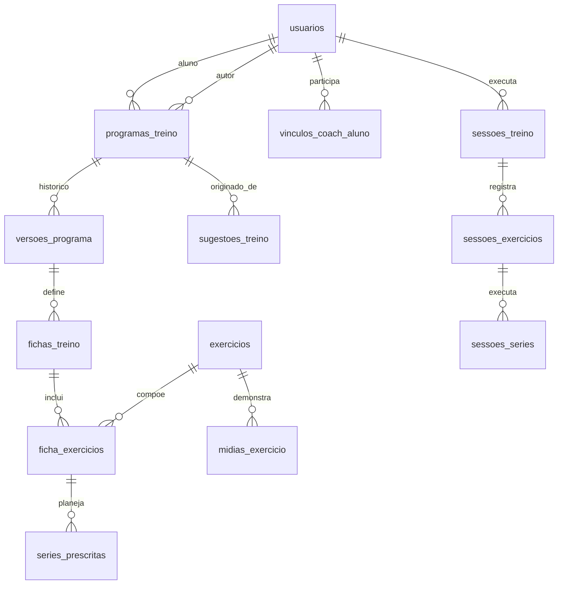

# CapiFit — Documento 04
## Modelagem de Dados, Regras de Domínio e DDL Inicial (MySQL 8)

**Versão:** 1.0 — proposta para implementação  
**Data:** 21/10/2026  
**Projeto:** CapiFit  
**Artefato complementar:** `04_schema_inicial_mysql8.sql`  
**Base de referência:** Documentos 01 (produto), 02 (jornadas) e 03 (interfaces).  
**Estado:** especificação técnica inicial; requer validação funcional, de segurança e migrations antes de produção.  
**Revisão 1.1 (21/10/2026):** o baseline deste documento é complementado pela **Migration 001** (`06_migration_001_reconciliacao.sql`, Documento 06), que passa a ser parte do schema oficial: +10 tabelas (34 no total), UUIDs adicionais, triggers de imutabilidade, sessão única em andamento, vínculos com histórico e aceite de prescrição. Em caso de divergência, o Documento 06 prevalece. A **Migration 002** (Documento 09) acrescenta a estrutura do catálogo (padrão de movimento, convenção de carga, áreas de cuidado, sinônimos).

---

## 1. Objetivo, escopo e premissas

Definir o domínio persistente do CapiFit, as relações entre alunos, coaches, exercícios, programas, fichas, sessões e sugestões, juntamente com regras de integridade, versionamento, autorização e sincronização offline. A modelagem suporta os **três modos de origem** de treino: `usuario`, `coach` e `app`. As três origens convergem para uma única estrutura de programa, ficha e execução.

**Stack de referência:** API PHP 8.x com `mysqli` e prepared statements, MySQL 8.0.16+ / InnoDB, UTF-8 `utf8mb4_general_ci`, app React Native + Expo com cache local SQLite, painel web em PHP + Bootstrap 5. **Não** acoplar entidades do domínio a telas ou à personagem Capi.

**Fora do detalhamento de implementação deste documento:** pagamentos, assinaturas, gestão de redes de academia, mensageria coach–aluno, prescrição clínica, autenticação completa, infraestrutura cloud e contratos definitivos das APIs. São extensões futuras ou documentos próprios.

## 2. Glossário de domínio

| Termo | Definição | Identificador de referência |
|---|---|---|
| Usuário | Conta autenticável, capaz de acumular papéis | `usuarios.id` |
| Coach | Papel com permissão de prescrever para aluno vinculado e autorizado | `usuarios_papeis` |
| Aluno | Pessoa titular dos treinos, sessões e preferências | `usuarios.id` |
| Exercício | Movimento cadastrado e curado, independente da ficha | `exercicios.id` |
| Programa | Agregado de treinos de um aluno, com origem, autor e histórico de versões | `programas_treino.id` |
| Versão | Fotografia lógica da prescrição em certo momento | `versoes_programa.id` |
| Ficha | Conjunto ordenado de exercícios (A, B, C...) pertencente à versão | `fichas_treino.id` |
| Série prescrita | Meta planejada para um exercício da ficha | `series_prescritas.id` |
| Sessão | Ocorrência efetiva de um treino, referindo-se à versão executada | `sessoes_treino.id` |
| Série realizada | Registro executado de carga, repetições, RIR e conclusão | `sessoes_series.id` |
| Sugestão | Saída auditável do motor de regras, sujeita à revisão | `sugestoes_treino.id` |
| Capi | Mascote, guia e demonstradora: sua mídia fica ligada ao exercício | `midias_exercicio.id` |

**Invariante principal:** exercício, prescrição e execução são entidades diferentes. Alterar uma não pode reescrever retroativamente as outras.

## 3. Visão relacional (alto nível)



O diagrama é conceitual e omite tabelas associativas e cadastros auxiliares. O script SQL contém as relações concretas.

## 4. Catálogo de tabelas do DDL

### 4.1 Identidade e acesso

| Tabela | Propósito | Observações |
|---|---|---|
| `usuarios` | Identidade, login, soft delete | E-mail único; senha com hash seguro; UUID público |
| `papeis` | Catálogo `aluno`, `coach`, `admin` | Papéis acumuláveis, não enum exclusivo no usuário |
| `usuarios_papeis` | Associação de papéis | Requer autorização no backend |
| `perfis_treinamento` | Nível, objetivo, disponibilidade, preferências e restrições | Dados pessoais/sensíveis: minimizar coleta e acesso |
| `vinculos_coach_aluno` | Convite, aceite, revogação e encerramento | Possibilidade de histórico completo discutida na seção 12 |

### 4.2 Biblioteca e mídia

| Tabela | Propósito | Observações |
|---|---|---|
| `grupos_musculares` | Taxonomia muscular | Cadastro curado |
| `equipamentos` | Taxonomia de equipamentos | Alimenta filtros e substituições |
| `exercicios` | Descrição, segurança e publicação | Somente publicados visíveis para usuários comuns |
| `exercicios_musculos` | Relação N:N e papel muscular | Primário ou secundário |
| `exercicios_alternativas` | Substitutos possíveis | Equivalência revisada por curadoria |
| `midias_exercicio` | Vídeos humanos, Capi, imagens e 3D | Status de revisão independente |

### 4.3 Prescrição e execução

| Tabela | Propósito | Observações |
|---|---|---|
| `programas_treino` | Agregado principal, dono, autor e origem | Nunca confundir `autor_id` com `aluno_id` |
| `versoes_programa` | Revisões da prescrição | Versões publicadas não devem ser editadas |
| `fichas_treino` | Divisões A/B/C etc. por versão | Ordenação estável |
| `ficha_exercicios` | Exercícios ordenados, descanso, superset | Repetições do mesmo exercício permitidas em posições diferentes |
| `series_prescritas` | Uma linha por série planejada | Permite aquecimento e faixas de repetição |
| `programas_ativos` | Programa e versão ativos por aluno | Uma escolha ativa por aluno no MVP |
| `sessoes_treino` | Instância de treino e seu ciclo de vida | FK para versão histórica |
| `sessoes_exercicios` | Lista de exercícios efetivamente executados | Permite substituição durante a sessão |
| `sessoes_series` | Registro factual das séries | Nunca derivar histórico só da ficha atual |

### 4.4 Inteligência, sincronização e trilhas

| Tabela | Propósito |
|---|---|
| `sugestoes_treino` | Entradas, justificativas e versão do gerador |
| `dispositivos_sync` | Identificação do dispositivo e revogação |
| `operacoes_sync` | Deduplicação e retorno de operações offline |
| `auditoria_eventos` | Registro de ações administrativas e relevantes |

**Total da proposta inicial:** 24 tabelas no baseline; **34 após a Migration 001** do Documento 06 (consentimentos, solicitações do titular, autenticação, idempotência, rate limit, profissionais, aceites de programa, pausas de sessão e modelos de sugestão).

## 5. Modelo híbrido: regras de origem, propriedade e publicação

**RG-001 — Titularidade:** todo programa pertence a exatamente um aluno (`aluno_id`). O autor (`autor_id`) pode ser esse aluno, um coach autorizado ou uma conta técnica do sistema, conforme origem.

**RG-002 — Programa do usuário (`origem='usuario'`):** aluno titular cria, edita, arquiva e ativa. Após publicação, uma edição gera **nova versão**; não altera as versões usadas no histórico.

**RG-003 — Programa do coach (`origem='coach'`):** somente coach com papel autorizado e vínculo **ativo, aceito e não revogado** pode prescrever ao aluno. Revogar vínculo impede novos acessos e novas publicações; sessões e histórico já pertencentes ao aluno continuam acessíveis a ele.

**RG-004 — Programa do app (`origem='app'`):** toda geração registra versão do motor e entradas relevantes. O aluno deve revisar antes de ativar. O motor não modifica unilateralmente um programa publicado ou uma sessão concluída.

**RG-005 — Personalização sem adulterar origem:** ao editar uma ficha recebida do coach, o aluno cria uma **cópia derivada** (`derivado_de_programa_id`) sob sua autoria, origem `usuario`, preservando a versão publicada pelo profissional. Mensagens de UX devem deixar explícito o tipo da cópia.

**RG-006 — Programa ativo:** apenas um por aluno no MVP; programa e versão ativos precisam corresponder ao mesmo titular. O banco garante programa–versão por FK composta; a equivalência entre o titular do ativo e o titular do programa é validada transacionalmente na aplicação.

**RG-007 — Publicação:** apenas versões completas, validadas e autorizadas podem passar para `publicado`. É proibido alterar fichas, exercícios ou séries de uma versão já publicada; isso exige política de domínio no backend, permissões do usuário do banco e testes.

**RG-008 — Coach e papéis:** conceder papel `coach` não equivale automaticamente a verificar credenciais profissionais; verificação, elegibilidade e regras regulatórias serão definidas separadamente.

## 6. Ciclo de vida e versionamento

### 6.1 Programa e versões

1. Criar programa `rascunho` e versão 1 `rascunho`.
2. Inserir uma ou mais fichas, exercícios e séries prescritas.
3. Validar estrutura, permissões e consistência em transação.
4. Publicar versão, atribuir `versao_atual_id` e tornar programa `publicado`.
5. Ao editar, clonar a versão para `numero + 1`; nunca editar a publicada.
6. Publicar nova versão e atualizar apontamento atual; conservar versões anteriores.
7. Sessões em andamento continuam referenciando a versão com que começaram.

### 6.2 Transações essenciais

- **Criar/publicar versão:** `BEGIN`; bloquear programa (`SELECT ... FOR UPDATE`); atribuir número sequencial; validar itens; publicar; atualizar apontamento; `COMMIT`. Em caso de erro, `ROLLBACK`.
- **Ativar programa:** bloquear escolha ativa do aluno; validar titularidade e versão publicada; inserir/atualizar `programas_ativos`; confirmar.
- **Iniciar sessão:** validar titularidade e ficha pertencente à versão; criar sessão e instâncias de exercícios/séries a partir da prescrição, na **mesma transação**.
- **Concluir sessão:** validar dono, estado e intervalos; atualizar estado e encerramento uma única vez. Requisições repetidas devem ser idempotentes.

### 6.3 Integridade histórica

Uma série realizada armazena fatos (`carga_kg`, `repeticoes`, `rir_real`, `concluida_em`) e referencia opcionalmente uma série prescrita. **Nunca** substituir valor histórico por valor calculado da prescrição atual. Para continuidade de relatórios após correções de catálogo, armazenar snapshots descritivos na versão das fichas e/ou em colunas de sessão em migration posterior, caso alterações/remoções de exercícios passem a ser permitidas. Exclusão física de entidades referenciadas é proibida no fluxo normal.

## 7. Execução das séries

**RG-009 — Sessão:** `em_andamento` → `concluida` ou `cancelada`; concluir/cancelar são estados terminais. Permitir retomar sessão em andamento, inclusive offline.

**RG-010 — Registros:** uma sessão inclui exercícios e séries próprias. Registrar somente repetições inteiras não negativas e cargas decimais não negativas; `repeticoes=0` pode representar tentativa sem repetição, mas série realizada exige decisão explícita de interface.

**RG-011 — Séries extras:** permitir adicionar uma série à sessão sem alterar a ficha prescrita; `serie_prescrita_id` é opcional.

**RG-012 — Substituições:** permitir trocar exercício dentro da sessão sem reescrever a ficha e registrar o exercício efetivo na sessão.

**RG-013 — Treinos concorrentes:** recomendação inicial é **uma sessão em andamento por aluno**, aplicada por transação/lock no backend; avaliar sessões paralelas caso o produto mude. Imposta pela Migration 001 (índice único sobre coluna gerada `em_andamento_chave`); a aplicação continua retornando `409 SESSION_ALREADY_OPEN` antes de chegar ao banco.

**RG-014 — Tempo:** datas de eventos em UTC no backend, exibição no fuso IANA do usuário; duração calculada pelos timestamps, com tratamento de relógios locais divergentes.

**RG-015 — Métricas:** volume de carga por sessão = soma de `carga_kg × repeticoes` em séries realizadas; comunicar que isso é um indicador operacional, não medida direta de hipertrofia. Em exercícios unilaterais, definir e documentar convenção de carga e lados antes do relatório avançado.

## 8. Motor de sugestões e progressão

### 8.1 Entradas e saídas

Entradas mínimas: nível declarado, objetivo, dias disponíveis, duração estimada, equipamentos, preferências e restrições declaradas. Saídas: divisão de fichas, exercícios, parâmetros sugeridos e justificativas. Registrar `motor_versao`, entradas e evento de aceitação/edição/descarte. Não depender de IA generativa para garantir consistência da prescrição.

### 8.2 Motor por regras no MVP

- Excluir indisponibilidades e conflitos com restrições declaradas, sem inferir segurança clínica automaticamente.
- Verificar distribuição por grupos musculares, duplicações e duração estimada.
- Apresentar o plano para revisão antes de publicar/ativar.
- Rejeitar entradas insuficientes; oferecer plano genérico sinalizado ou solicitar os dados faltantes.
- Facilitar edição e substituição pelo aluno.

### 8.3 Progressão assistida [fase posterior]

Calcular sugestões a partir da faixa prescrita, histórico, RIR quando disponível, consistência de execução e informação sobre desconforto/recuperação. Toda alteração de carga é **sugestão**, não comando automático. Manter histórico da recomendação e aceitação numa futura tabela `recomendacoes_progressao`; não há tal tabela no DDL MVP. Não utilizar diagnóstico ou promessas clínicas.

## 9. Mascote Capi e mídia de exercícios

A Capi é um **componente de apresentação e conteúdo**, não um novo tipo de exercício. O mesmo `exercicios.id` pode conter várias mídias com `tipo='video_capi'`, `video_humano`, `imagem`, `animacao_3d`.

**RG-016:** somente mídia `aprovado` entra na experiência padrão. Mídia `em_revisao` jamais substitui demonstração publicada automaticamente.

**RG-017:** vídeos e animações de técnica precisam de validação por pessoa tecnicamente qualificada; observar limites anatômicos do personagem estilizado e oferecer alternativas explicativas adequadas.

**RG-018:** armazenar no banco metadados e caminho controlado da mídia, não binário. Usar storage privado/público conforme licença e CDN quando cabível; considerar checksum, duração, idioma, resolução, legenda e versão de conteúdo em migration posterior.

## 10. Sincronização offline e resolução de conflitos

### 10.1 Modelo

SQLite local guarda a sessão em andamento, séries, estado da operação e fila de envio. Cada objeto relevante tem UUID público e cada operação enviada tem `operacao_uuid` estável para repetição segura.

### 10.2 Contrato mínimo

1. Dispositivo autentica e obtém programas/fichas publicados com um marcador de sincronização.
2. Ao ficar offline, registra mutações na fila local, em ordem por entidade.
3. Ao reconectar, envia operações com UUID, versão/revisão da entidade (a acrescentar ao contrato/API) e timestamp local informativo.
4. API valida titularidade, autorização e pré-condições antes de gravar.
5. Persistir resultado em `operacoes_sync`, com chave única `(usuario_id, operacao_uuid)`. Retry da mesma operação **devolve o mesmo resultado**.
6. Confirmar ao dispositivo somente depois do commit. Operações rejeitadas/conflitantes permanecem visíveis ao usuário.

### 10.3 Política proposta de conflitos

| Situação | Comportamento |
|---|---|
| Mesmo UUID de operação reapresentado | Não aplicar novamente; devolver resultado armazenado |
| Série distinta modificada em outro dispositivo | Mesclar se não houver competição pelo mesmo registro |
| Mesma série modificada em dois dispositivos | Bloquear sobrescrita silenciosa; pedir revisão ou resolver por regra explícita |
| Ficha publicada alterada durante sessão offline | Conservar versão referenciada na sessão; oferecer versão nova para treinos futuros |
| Vínculo coach revogado enquanto offline | Não aceitar novas publicações ou consultas privilegiadas na sincronização |
| Usuário excluído ou sessão revogada | Invalidar permissões e impedir novo upload; aplicar política de retenção |

**Importante:** o DDL traz idempotência básica, **não implementa sozinho** protocolo completo de sync, cursor de alterações ou controle de concorrência otimista. Incluir `revision`/ETag, tombstones, cursor incremental e políticas de resolução no documento de APIs e nas migrations correspondentes.

## 11. Matriz de autorização (servidor)

| Operação | Aluno titular | Coach vinculado ativo | Admin |
|---|---|---|---|
| Ler perfil próprio | Sim | Não aplicável | Acesso restrito e auditado |
| Editar programa próprio de origem usuário | Sim | Não | Suporte excepcional |
| Publicar prescrição coach | Não | Sim, se autorizado | Não rotineiramente |
| Consultar histórico do aluno | Sim | Com permissão vigente específica | Somente necessidade operacional |
| Executar/registrar séries | Sim | Não | Não |
| Publicar mídia de exercício | Não | Não por padrão | Curador autorizado |
| Revogar vínculo coach | Sim | Pode encerrar seu vínculo | Mediação auditada |

**Requisitos:** autorizar em cada endpoint por `aluno_id` e vínculo; jamais confiar em IDs do payload. Prepared statements `mysqli`, validação de tipos, rate limiting e trilha de eventos para alterações sensíveis. Hash de senha com `password_hash()`/`password_verify()`; segredos e tokens não armazenados em texto puro. Autorização de administrador deve seguir princípio de menor privilégio.

## 12. Privacidade, proteção de dados e exclusão

- Definir fundamento legal adequado, transparência, finalidade e consentimentos quando cabíveis à categoria de dados; dados de saúde exigem cuidados adicionais à luz da LGPD.
- Coletar apenas informações necessárias para montar e acompanhar treino. **Não** tornar restrições de saúde campo obrigatório sem justificativa.
- Limitar acesso do coach ao mínimo necessário e revogável. O término do vínculo corta acesso futuro, respeitadas obrigações legais eventualmente aplicáveis.
- Definir política de exportação e eliminação; `usuarios.excluido_em` e estado `excluido` são marcadores de workflow, **não substituem** anonimização/eliminação efetiva ou retenção legalmente justificada.
- Evitar dados sensíveis em `auditoria_eventos.metadados_json`, logs de aplicação, analytics e crash reports.
- Proteger dados em trânsito e repouso, gerir chaves fora do banco e auditar acessos privilegiados.
- **Vínculos (resolvido na Migration 001):** a unicidade `(coach_id,aluno_id)` foi substituída por unicidade apenas do vínculo **vigente** (`pendente` ou `ativo`), preservando um registro por período; o vínculo ganhou escopo de compartilhamento (`compartilha_historico`, `compartilha_restricoes`) e estados `recusado`/`expirado`.

## 13. Índices, performance e banco

Índices centrais do DDL: `usuarios.email`, `exercicios(nome_normalizado,status)`, `programas_treino(aluno_id,status)`, `sessoes_treino(aluno_id,iniciada_em)`, `operacoes_sync(usuario_id,operacao_uuid)` e FKs relevantes. Para páginas maiores, paginação por cursor de data/ID, preferível a `OFFSET` profundo. Evitar joins pesados ao abrir o executor: carregar apenas ficha, exercícios, séries e mídia necessária.

Exemplos de otimização futura: índices por data de conclusão; agregados semanais para dashboard; tabela de métricas materializadas para relatórios frequentes; storage/CDN de vídeos; tarefas assíncronas para renderização da Capi.

## 14. Padrões de modelagem e nomenclatura

- Tabelas em `snake_case`, nomes portugueses, PK numérica interna `BIGINT UNSIGNED`, UUID estável de exposição/sincronização.
- Valores monetários, quando existirem, em decimal ou inteiro de centavos (não float).
- Cargas em `DECIMAL(7,2)` kg; conversão da preferência visual lb/kg ocorre na aplicação.
- Datas `DATETIME(6)` interpretadas pela API como UTC; evitar perda de timezone na serialização.
- `ON DELETE` conservador no histórico: não usar cascata para apagar execuções.
- `JSON` para preferências/justificativas flexíveis; campos consultados/fundamentais devem ser colunas tipadas e indexáveis.
- Para operações multi-etapa, transações explícitas; lock do agregado, tratamento de deadlocks e retry idempotente.
- Evolução por migrations SQL versionadas, com scripts `up` e `down` sempre que reversão for segura.

## 15. Fluxos de persistência de ponta a ponta

### 15.1 Montagem manual

`POST programa(origem=usuario)` → criar versão rascunho → inserir fichas → inserir exercícios e séries → validar → publicar nova versão → marcar como ativa. Nunca iniciar uma sessão a partir de rascunho.

### 15.2 Prescrição do coach

Validar papel + vínculo ativo → coach cria programa para `aluno_id` → versão rascunho → publicá-la → disponibilizar ao aluno → aluno aceita/ativa. **Resolvido (Documento 06 §6):** o aceite explícito é registrado em `aceites_programa`; aceitar não ativa o programa; rascunhos do coach não são visíveis ao aluno.

### 15.3 Sugestão automática

Coletar entradas → registrar `sugestoes_treino` → gerar rascunho do programa com origem app → apresentar justificativas/alternativas → aluno edita (gerando cópia ou revisão) → publicar/ativar após validação.

### 15.4 Treino offline

Selecionar versão publicada disponível localmente → criar UUID de sessão → gerar instâncias de séries → marcar progressivamente concluídas → registrar operações na fila → sincronizar com idempotência, validação e preservação da versão.

## 16. Testes e critérios de aceitação

| ID | Dado / Quando | Esperado |
|---|---|---|
| CA-04-01 | Aluno cria programa próprio e publica | Programa acessível e versão imutável |
| CA-04-02 | Aluno edita programa publicado | Nova versão criada; anterior intacta |
| CA-04-03 | Sessão iniciada na v1, programa migrado à v2 | Sessão continua vinculada à v1 |
| CA-04-04 | Coach sem vínculo tenta publicar | `403`, nenhuma escrita |
| CA-04-05 | Coach revogado tenta ler histórico | Acesso negado conforme permissões vigentes |
| CA-04-06 | Aluno altera ficha de coach | Cópia própria; original preservado |
| CA-04-07 | App gera sugestão | Versão do motor e entradas rastreáveis |
| CA-04-08 | Séries com carga/reps negativas | Escrita rejeitada |
| CA-04-09 | Duplo envio do mesmo UUID de operação | Aplicação única |
| CA-04-10 | Dois dispositivos alteram mesma série | Conflito explícito, sem perda silenciosa |
| CA-04-11 | Exercício não publicado é listado no catálogo público | Ocultado |
| CA-04-12 | Mídia Capi não aprovada | Não apresentada como técnica validada |
| CA-04-13 | Aluno conclui sessão offline | Histórico aparece após sync, sem duplicação |
| CA-04-14 | Sessão encerrada recebe atualização indevida | Rejeitada segundo contrato |
| CA-04-15 | Versão com ficha de outro programa é ativada | Rejeição por integridade/titularidade |
| CA-04-16 | Usuário acessa registro de outro aluno por ID | `403` ou `404`, sem vazamento |
| CA-04-17 | Programa é arquivado | Históricos continuam consultáveis |
| CA-04-18 | Exportação/remoção de dados é solicitada | Segue workflow LGPD documentado |

**Validação automatizada:** suíte de integração MySQL em banco temporário, dados mínimos de fixture, execução de migrations, integridade referencial, concorrência (duas conexões), teste de autorização horizontal e idempotência de rede.

## 17. SQL de referência e limitações conscientes

Arquivo complementar: [`04_schema_inicial_mysql8.sql`](./04_schema_inicial_mysql8.sql).

O arquivo foi concebido para **banco novo**, não para execução direta sobre produção. Ele define 24 tabelas, FKs, índices, `CHECK` e valores de domínio. É um *baseline*, não uma migration pronta para deploy. Antes da implementação de API:

1. Criar migrations incrementais, seed de grupos/equipamentos e fixtures de teste.
2. Implementar locks/transações e validação de papéis/origem/titularidade no serviço de domínio.
3. Impor imutabilidade de versões publicadas por regras da API, testes e permissões de banco apropriadas.
4. Acrescentar revisão de entidades para concorrência offline e mecanismo de cursor de sincronização.
5. Determinar política de múltiplos coaches, histórico de vínculos e aceite das prescrições.
6. Resolver autoria de programas gerados pelo app: conta de serviço dedicada ou `autor_id` do próprio aluno com trilha `origem='app'` (preferência inicial: aluno como autor técnico e geração registrada, evitando conta fictícia).
7. Adicionar validações intertabelas não garantidas pelo SQL: ficha pertence à versão informada da sessão; série prescrita pertence ao exercício da sessão; versão ativa pertence ao mesmo aluno; mídia aprovada por curador; exercício deve estar elegível para publicação.
8. Revisar nomes e contratos com as especificações de API e tela antes do freeze de schema.

**Status dos itens acima após a Migration 001:** (1) migrations incrementais — iniciadas (Migration 001); (3) imutabilidade — imposta por triggers; (4) revisão de entidades — `versoes_programa.revision` e `sessoes_series.revision`; (5) vínculos e aceite — resolvidos; (6) autoria do app — resolvida (aluno como autor, D-10); (7) FKs compostas ficha↔versão e programa↔titular adicionadas, demais validações permanecem na aplicação (lista no Documento 06 §5). Itens 2 (locks/transações) e 8 (freeze de schema) continuam abertos.

### Comando para ambiente local descartável

```bash
mysql -u <usuario> -p < 04_schema_inicial_mysql8.sql
```

O comando acima contém placeholders e deve ser executado somente após configurar um usuário com acesso adequado em ambiente **não produtivo**.

## 18. Entregáveis, decisões e sequência

**Entregue:** documento de domínio, ERD lógico, dicionário de 24 tabelas, baseline SQL MySQL 8, requisitos de transação e sync, matriz de segurança, regras de mídia da Capi e critérios de aceitação.

**Pontos para decisão antes do MVP:** (a) múltiplos vínculos simultâneos de coaches e aceite explícito; (b) retenção do histórico após exclusão; (c) convenção de exercícios unilaterais; (d) critérios para uma sessão simultânea; (e) primeira versão do motor de regras; (f) licenciamento e revisão das animações; (g) credenciais e comprovação profissional para coach.

**Documento 05 recomendado — Contratos da API REST, autenticação e autorização:** endpoints, payloads, erros, filtros, paginação, DTOs, contratos de sync, idempotência, revisões, tokens, validações, regras de publicação e testes. Os identificadores `TEL-*` do Documento 03 serão associados às APIs necessárias.

---

**Registro de versão:** v1.0 — primeira proposta para revisão de engenharia e produto. Mudanças futuras devem ser rastreadas em changelog e migrations versionadas.
