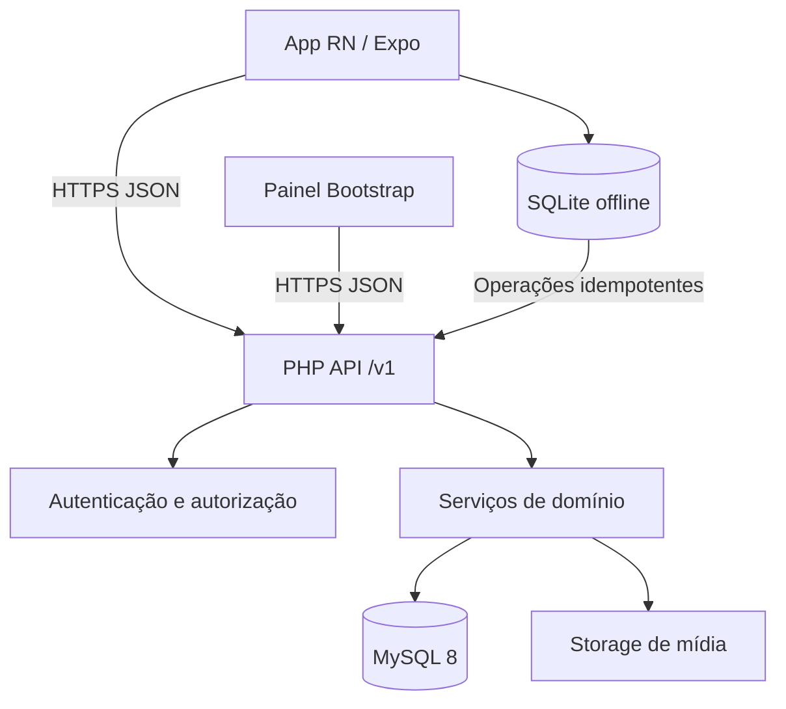

# CapiFit — Documento 05
## Arquitetura e Contratos da API REST

**Versão:** 1.0 — baseline de implementação  
**Data:** 21/10/2026  
**Status:** Especificação proposta; contratos sujeitos à revisão antes do desenvolvimento  
**Dependências:** Documentos 01–04 e `04_schema_inicial_mysql8.sql`.  
**Revisão 1.1 (21/10/2026):** reconciliado pelo Documento 06 (que prevalece em caso de divergência): IDs públicos sempre UUID, rotas de coach por `{aluno_uuid}`/`{coach_uuid}`, `409 VERSION_IMMUTABLE`, concorrência de séries por última-escrita-vence, criação de sessão com snapshot, ciclo de aceite de prescrição e endpoints novos (§8 do Doc 06).

---

## 1. Objetivo

Definir padrões de implementação do backend PHP 8.x, contratos HTTPS/JSON, permissões, autenticação, APIs de biblioteca de exercícios, montagem híbrida de programas, prescrição por coaches, execução de séries, motor de sugestões, sincronização offline, painel administrativo, erros e testes. Este documento é normativo para o desenvolvimento inicial, exceto itens marcados **Fase posterior** ou **Decisão pendente**.

**Princípio central:** aluno, coach e aplicativo criam programas pelo mesmo modelo canônico (`programas_treino` → `versoes_programa` → `fichas_treino` → `ficha_exercicios` → `series_prescritas`). O registro real é separado (`sessoes_treino` → `sessoes_exercicios` → `sessoes_series`) e não pode ser reescrito por alterações futuras de prescrição.

## 2. Premissas e arquitetura

- **Cliente:** React Native + Expo, com SQLite local para fila offline; painel web PHP/Bootstrap 5.
- **Servidor:** PHP 8.2+ recomendado; API REST em HTTPS, controller → service → repository (`mysqli` com prepared statements; **não** PDO).
- **Banco:** MySQL 8.0.16+, InnoDB, `utf8mb4_general_ci`; identificadores internos `BIGINT` e UUIDs em recursos sincronizáveis.
- **Mídia:** armazenamento de objetos; a API expõe URL temporária/autorizada e metadados, sem arquivos binários em JSON.
- **Relógio:** persistência em UTC, transporte ISO 8601 `2026-10-21T15:00:00Z`; cliente formata no fuso local.
- **Segurança:** TLS, autenticação curta e refresh revogável, escopo por aluno, auditoria de ações relevantes, redução dos dados de saúde expostos.
- **Transações:** publicação, ativação, criação de sessões e confirmação de operações offline devem ser atômicas quando envolverem múltiplas tabelas.



### 2.1 Organização sugerida de código

```text
backend/
  public/index.php
  src/Http/{Router,Request,Response,Middleware}/
  src/Controllers/V1/
  src/Services/{Auth,Exercise,Program,Session,Suggestion,Sync}/
  src/Repositories/
  src/Policies/
  src/DTO/
  src/Validators/
  src/Infrastructure/{Database,Clock,Storage,Logger}/
  database/migrations/
  tests/{Unit,Integration,Contract}/
```

A camada de serviço aplica regras de negócio; controladores não executam SQL. Não utilizar acesso direto a bancos pelo app.

## 3. Convenções gerais do contrato

- Base: `https://api.<dominio-a-definir>/v1` (placeholder; não é URL operacional).
- Recursos no plural, minúsculos, com hífen: `/programas/{id}/versoes`.
- `Content-Type: application/json; charset=utf-8` e `Accept: application/json`.
- Autorização: `Authorization: Bearer <access_token>`; tokens jamais em query string.
- Mutação criada pelo cliente: `Idempotency-Key: <uuid>` nos endpoints indicados.
- IDs em respostas públicas: **sempre UUID** (a Migration 001 acrescentou UUID a fichas, exercícios de ficha, séries prescritas e exercícios de sessão). Os exemplos deste documento que usam inteiros como `"218"` devem ser lidos como `exercicio_uuid`, `ficha_uuid` etc. Não expor IDs de banco nem usá-los como dado de autorização.
- API usa `snake_case` nos JSONs, coerente com banco; campos de data com sufixo `_em`.
- PATCH para mutação parcial; PUT apenas para substituição total quando expressamente documentada.
- Erros nunca revelam stack trace, SQL, tokens ou dados sensíveis.
- Paginação por cursor (`limit` de 1–100, padrão 20); retorno `next_cursor`. Ordenação estável por `(criado_em, id)` ou chave adequada.
- Exclusão lógica onde apropriado; recursos históricos não são apagados pelo CRUD comum.

### 3.1 Envelope de sucesso

```json
{
  "data": {"id": "27f2920f-b0f1-4624-9f9e-36f3ef876a05", "titulo": "Treino ABC"},
  "meta": {"request_id": "req_01J...", "schema_version": "1.0"}
}
```

Para listas:

```json
{
  "data": [{"id": "218", "nome": "Supino reto"}],
  "pagination": {"limit": 20, "next_cursor": null},
  "meta": {"request_id": "req_01J..."}
}
```

### 3.2 Erros estáveis

```json
{
  "error": {
    "code": "PROGRAM_VERSION_CONFLICT",
    "message": "A versão do programa foi alterada. Atualize os dados.",
    "details": {"expected_version": 2, "current_version": 3},
    "request_id": "req_01J..."
  }
}
```

| HTTP | Uso | Código de exemplo |
|---|---|---|
| 200 | Consulta/alteração concluída | — |
| 201 | Recurso criado | — |
| 202 | Processamento aceito (se usado futuramente) | — |
| 204 | Revogação sem corpo | — |
| 400 | JSON inválido, parâmetro malformado | `INVALID_JSON` |
| 401 | Token ausente/inválido/expirado | `UNAUTHENTICATED` |
| 403 | Sem papel ou vínculo adequado | `FORBIDDEN` |
| 404 | Recurso inexistente ou invisível ao ator | `RESOURCE_NOT_FOUND` |
| 409 | Versão obsoleta, operação concorrente | `PROGRAM_VERSION_CONFLICT` |
| 422 | Violação de regra de domínio/validação | `VALIDATION_ERROR` |
| 429 | Limite de requisições | `RATE_LIMITED` |
| 500 | Falha inesperada (sem informação interna) | `INTERNAL_ERROR` |
| 503 | Dependência indisponível | `SERVICE_UNAVAILABLE` |

`422` admite `details.fields` como mapa de campo → mensagens. Resposta de `429` inclui `Retry-After`. Campos extras de entrada não documentados são rejeitados, em vez de ignorados silenciosamente.

## 4. Autenticação e sessão

### 4.1 Endpoints

| Verbo | Rota | Propósito | Auth |
|---|---|---|---|
| POST | `/auth/register` | Criar conta de aluno | Pública |
| POST | `/auth/login` | Login e tokens | Pública |
| POST | `/auth/refresh` | Renovar credenciais com rotação | Refresh |
| POST | `/auth/logout` | Revogar sessão atual | Bearer |
| POST | `/auth/logout-all` | Revogar todas as sessões | Bearer |
| POST | `/auth/password/forgot` | Iniciar recuperação | Pública |
| POST | `/auth/password/reset` | Trocar senha com token de uso único | Pública |
| POST | `/auth/email/verify` | Confirmar endereço eletrônico | Token específico |
| GET | `/me` | Perfil mínimo, papéis e configurações | Bearer |
| PATCH | `/me` | Alterar nome e dados não sensíveis | Bearer |
| GET | `/me/perfil-treinamento` | Perfil de treino do próprio usuário | Bearer |
| PUT | `/me/perfil-treinamento` | Criar/substituir perfil | Bearer |

**Decisão de segurança:** access token de curta duração (exemplo: 15 min); refresh opaco aleatório, com hash no servidor, rotação e revogação por dispositivo; armazenar credenciais com Keychain/Keystore no app. Implementar limitação por IP/conta, verificação de senha com `password_hash`/`password_verify` e proteção contra enumeração de e-mail.

**Decisões de implementação da autenticação (E01-01/E01-02, 22/10/2026):**

- **Access token:** JWT HS256 de 15 min (`ACCESS_TOKEN_TTL`); claims `iss`, `sub` (UUID do usuário), `sid` (UUID da sessão), `iat`, `nbf`, `exp`, `jti`. Segredo com **mínimo de 32 bytes** (`JWT_SECRET`); a biblioteca é `firebase/php-jwt` **v7** (a v6 tem o aviso CVE-2025-45769 por não impor tamanho mínimo de chave). Algoritmo fixo: tokens `alg: none` ou assinados com outra chave são rejeitados.
- **Verificação por requisição:** além do JWT, o servidor confere no banco que a sessão (`sid`) **não foi revogada** e que a conta está `ativo`; papéis vêm do banco, não do token. Logout, suspensão e logout-all valem **imediatamente**, sem esperar o token expirar. Toda falha devolve o mesmo `401 UNAUTHENTICATED`.
- **Refresh token:** opaco (256 bits, base64url), validade de 30 dias (`REFRESH_TOKEN_TTL`), guardado **somente como SHA-256**. A cada uso há **rotação** (novo token na mesma "família"). Reuso de um token já rotacionado, **depois** da janela de tolerância (`REFRESH_REUSE_GRACE`, 10 s), indica roubo: a família inteira é revogada e o evento é registrado (só o identificador opaco da família). Dentro da janela, a segunda chamada apenas recebe `401` (renovações simultâneas do mesmo cliente não derrubam a sessão); o app deve **serializar** as renovações (uma por vez).
- **Cadastro:** `409 EMAIL_ALREADY_REGISTERED` para e-mail repetido (comparação sem diferenciar maiúsculas; o e-mail é guardado em minúsculas); `422 UNDERAGE_NOT_ALLOWED` quando `maior_de_18` é `false` (nada é gravado); campos desconhecidos geram `422`. A conta nasce `ativo` com `email_verificado_em` nulo (a verificação por e-mail é a história E01-03). Consentimentos de termos e de privacidade são gravados na mesma transação.
- **Login:** a verificação de senha (Argon2id) roda mesmo quando o e-mail não existe, para não revelar contas pelo tempo de resposta; a mensagem de falha é a mesma. A senha é re-hasheada se os parâmetros do algoritmo mudarem.
- **Limite de taxa (E01-05):** janela fixa contada no banco (`limites_requisicao`) — registro 10/h por IP; login 30/15 min por IP e 10/15 min por e-mail; renovação 60/15 min por IP; recuperação de senha 10/h por IP e 3/h por e-mail; redefinição 10/h; verificação 20/h por IP. Excedeu: `429 RATE_LIMITED` com `Retry-After`. O banco guarda só um HMAC do IP/e-mail (nunca em claro); `X-Forwarded-For` só vale com `TRUST_FORWARDED_FOR=1` atrás de proxy confiável. Valores iniciais, a calibrar no beta.
- **Recuperação de senha e verificação de e-mail (E01-03):** `POST /auth/password/forgot` responde `204` igual para conta existente, inexistente ou suspensa (sem enumeração). O token (256 bits) vai por e-mail em um link, é guardado só como SHA-256, vale 1 h (recuperação) ou 24 h (verificação) e é de uso único; um pedido novo invalida o anterior. `reset` revoga **todas** as sessões da conta e comprova o e-mail; senha inválida **não** gasta o token. Token inexistente, expirado, usado ou de outro tipo devolve o mesmo `422` ("Link inválido ou expirado"). Falha de envio não derruba o cadastro e não vai para o log (sem destinatário nem conteúdo).
- **Pendente:** envio real de e-mail (provedor SMTP/API depende da hospedagem — Doc 12 §8). Até lá, `NullMailer` não envia e avisa no log; em `APP_ENV=local`, `FileMailer` grava os e-mails em `backend/storage/mail/`. Não há rota para reenviar a verificação (fora do contrato atual).
- **Programas manuais (E06-01) e treino a partir da ficha (E07-12):** só o dono acessa (outro usuário recebe `404`). `POST /me/programas` cria o programa em `rascunho` com a versão 1 vazia. A estrutura (fichas → exercícios → séries) é substituída por inteiro em `PUT /programas/{id}/versoes/{n}/estrutura` com `expected_revision`; revisão velha devolve `409 REVISION_CONFLICT` (com a revisão atual) e versão já publicada devolve `409 VERSION_IMMUTABLE`. Publicar exige ao menos uma ficha com exercício, todos ainda publicados, é idempotente e **não ativa** o programa; editar um programa publicado é criar uma nova versão (`POST .../versoes`, cópia da vigente; se já houver rascunho, `409 PROGRAM_VERSION_CONFLICT`). `POST /programas/{id}/ativar` só aceita versão publicada e vigente e troca o ativo (um por aluno); arquivar remove dos ativos e bloqueia novas alterações e novos treinos. Programa de coach só aparece ao aluno depois do aceite, nunca é editável por ele (`403`) e a saída para personalizar é `POST .../copiar` (`origem=usuario`, `derivado_de` aponta ao original). `POST /me/sessoes` com `ficha_uuid` cria sessão `programado` ligada à versão e à ficha, **copiando** exercícios (`tipo_item=prescrito`) e séries prescritas (pendentes): editar o programa depois não altera treinos já iniciados. Ficha de rascunho, de programa arquivado ou de outro usuário é `422` em `ficha_uuid`. O envio do instantâneo `exercicios` continua `501` até a sincronização offline (E08-04).

**Lacuna no DDL 04:** adicionar migrations para `sessoes_autenticacao`, `tokens_acao` (recuperação/verificação), revogações e, se aplicável, `consentimentos_privacidade`. Não tentar gravar refresh tokens no campo `usuarios.senha_hash`.

#### Exemplo de login

**POST `/auth/login`**

```json
{"email":"aluna@example.com","senha":"senha-fornecida-pelo-usuario","dispositivo_uuid":"6fc186b1-c144-4899-ad74-8bde6982a601"}
```

**200**

```json
{
  "data": {
    "access_token": "<token-omitido>",
    "expires_in": 900,
    "refresh_token": "<token-omitido>",
    "token_type": "Bearer",
    "usuario": {"id":"1c9ac2e3-3e44-4f8d-b1cc-9c3f2cf185df","nome":"Ana","papeis":["aluno"]}
  }
}
```

Os tokens acima são marcadores ilustrativos, não credenciais reais. Toda troca de refresh token invalida a versão anterior, com política de concorrência documentada para chamadas simultâneas.

## 5. Identidade, papéis e autorização

Três papéis globais: `aluno`, `coach`, `admin` (DDL `usuarios_papeis`). Um usuário pode ter múltiplos papéis; autorização por papel **e** propriedade/vínculo e status do recurso.

| Ação | Aluno titular | Coach vinculado ativo | Coach não vinculado | Admin |
|---|---|---|---|---|
| Ler própria ficha | Sim | Ler ficha do aluno com vínculo | Não | Sob autorização operacional |
| Criar programa do aluno | Sim | Sim, como `origem=coach` | Não | Apenas administração auditada |
| Publicar prescrição do coach | Não sobre prescrição original | Sim, se autor e vínculo ativo | Não | Excepcional, auditada |
| Registrar série de treino | Sim | Não por padrão | Não | Não por padrão |
| Ler histórico de execução | Sim | Sim conforme consentimento/vínculo | Não | Acesso restrito e auditado |
| Revisar mídia Capi | Não | Não por padrão | Não | Sim, após validação técnica |

**Regras críticas:** (1) nunca confiar em `aluno_id`, `autor_id`, `origem` ou `coach_id` fornecidos pelo cliente para contornar direitos; (2) conferir vínculo `ativo` em `vinculos_coach_aluno` a cada operação protegida; (3) vínculo encerrado retira acesso futuro, mantendo histórico do aluno; (4) coach não altera treino executado por aluno; (5) escopo admin segue privilégio mínimo.

## 6. Biblioteca de exercícios e mídia da Capi

| Verbo | Rota | Uso |
|---|---|---|
| GET | `/exercicios` | Busca por `q`, `grupo_id`, `equipamento_id`, `limit`, `cursor` |
| GET | `/exercicios/{id}` | Detalhe, músculos, alternativas, mídia aprovada |
| GET | `/grupos-musculares` | Catálogo |
| GET | `/equipamentos` | Catálogo |
| GET | `/exercicios/{id}/alternativas` | Alternativas publicadas |
| GET | `/exercicios/{id}/midias` | Mídia aprovada, inclusive `video_capi` |
| POST | `/admin/exercicios` | Criar exercício (admin) |
| PATCH | `/admin/exercicios/{id}` | Atualizar rascunho (admin) |
| POST | `/admin/exercicios/{id}/publicar` | Publicar após revisão |
| POST | `/admin/exercicios/{id}/midias` | Vincular mídia já carregada no storage |
| POST | `/admin/midias/{id}/aprovar` | Aprovação técnica e editorial |

**GET `/exercicios/{id}` — 200**

```json
{
  "data": {
    "id": "218",
    "nome": "Supino reto com barra",
    "equipamento": {"id":"4","nome":"Barra"},
    "musculos": [{"id":"2","nome":"Peitoral","papel":"primario"}],
    "unilateral": false,
    "instrucoes": "Demonstração técnica revisada por profissional.",
    "midias": [{"id":"53","tipo":"video_capi","versao":"1","url":"https://cdn.exemplo.invalid/media/53","status":"aprovado"}]
  }
}
```

O domínio `exemplo.invalid` é intencional e não é um serviço. Nunca expor mídia `rascunho`, `rejeitado` ou `em_revisao` a usuários finais. URLs precisam de expiração ou política controlada de distribuição; fornecer texto técnico alternativo e fallback quando a animação da Capi não estiver disponível.

## 7. Programas e montagem híbrida

### 7.1 Catálogo de endpoints

| Verbo | Rota | Regras principais |
|---|---|---|
| GET | `/me/programas` | Listar próprios programas, filtros `origem`, `status` |
| POST | `/me/programas` | Criar programa manual (`origem=usuario`) |
| GET | `/programas/{id}` | Ler programa autorizado |
| PATCH | `/programas/{id}` | Editar metadados de rascunho |
| POST | `/programas/{id}/versoes` | Criar versão rascunho copiando a publicada ou anterior |
| GET | `/programas/{id}/versoes/{numero}` | Ler versão e composição |
| PUT | `/programas/{id}/versoes/{numero}/estrutura` | Substituir estrutura de versão **rascunho** |
| POST | `/programas/{id}/versoes/{numero}/publicar` | Validar e publicar atomicamente |
| POST | `/programas/{id}/ativar` | Tornar versão publicada ativa do aluno |
| POST | `/programas/{id}/arquivar` | Arquivar sem apagar histórico |
| POST | `/programas/{id}/copiar` | Criar cópia editável e registrar procedência |
| GET | `/me/programa-ativo` | Retornar programa e versão ativos |

Escolha de granularidade: no MVP, a edição estrutural usa um único `PUT .../estrutura` transacional, reduzindo estados parciais e facilitando o cliente offline. Na fase posterior, podem surgir endpoints granulares por ficha/exercício/série.

### 7.2 Criação manual

**POST `/me/programas`** com `Idempotency-Key`:

```json
{"titulo":"ABC — hipertrofia","objetivo":"hipertrofia"}
```

**201**: `data` com `id` (UUID), `origem:"usuario"`, `status:"rascunho"`, `versao_atual:null`, `versao_rascunho:1`. O servidor fixa `aluno_id` e `autor_id` do token e inicializa `versoes_programa.numero=1`.

### 7.3 Estrutura da versão

**PUT `/programas/{id}/versoes/1/estrutura`**:

```json
{
  "expected_revision": 3,
  "fichas": [
    {
      "codigo": "A", "titulo": "Peito e tríceps", "ordem": 1,
      "exercicios": [
        {
          "exercicio_id": "218", "ordem": 1, "descanso_segundos": 90,
          "grupo_superset": null,
          "series": [
            {"ordem":1,"tipo":"normal","reps_min":8,"reps_max":12,"carga_alvo_kg":40,"rir_alvo":2},
            {"ordem":2,"tipo":"normal","reps_min":8,"reps_max":12,"carga_alvo_kg":40,"rir_alvo":2}
          ]
        }
      ]
    }
  ]
}
```

Validações: pelo menos uma ficha com exercício para publicação, exercícios `publicado`, ordem única, faixas de repetição consistentes, descanso entre 0–3600, `rir_alvo` 0–10, carga não negativa. `expected_revision` deve ser verificada sob lock.

**Lacuna no DDL 04:** `versoes_programa` não possui `revision`/`atualizado_em`. Criar migration para `revision INT UNSIGNED DEFAULT 1` e carimbo, antes de usar concorrência otimista; alternativamente ETag persistente. Sem essa migration, não prometer verificação de concorrência por versão.

### 7.4 Publicar e ativar

Publicar em transação: lock da versão/programa, validar propriedade e estado, garantir composição válida, mudar `versoes_programa.estado`, atualizar `programas_treino.versao_atual_id` e estado público; versões anteriores continuam existentes e são marcadas `substituido` se aplicável. Não permitir PUT em versão publicada. Ativar somente versão publicada associada ao aluno, via `programas_ativos`, em transação com lock por `aluno_id`.

**POST `/programas/{id}/ativar`**:

```json
{"versao_numero":2}
```

Resultado: `200` com `programa_id`, `versao_numero`, `ativado_em`. Uma sessão já iniciada continua apontando para sua versão original.

### 7.5 Convites e prescrição coach–aluno

| Verbo | Rota | Propósito |
|---|---|---|
| POST | `/coach/convites` | Criar convite de vínculo (coach) |
| GET | `/me/convites` | Listar solicitações recebidas |
| POST | `/me/convites/{id}/aceitar` | Aluno aceita vínculo |
| POST | `/me/convites/{id}/recusar` | Aluno recusa |
| DELETE | `/me/coaches/{coach_uuid}` | Aluno encerra vínculo |
| GET | `/coach/alunos` | Listar alunos com vínculo ativo |
| POST | `/coach/alunos/{aluno_uuid}/programas` | Criar programa para aluno |
| GET | `/coach/alunos/{aluno_uuid}/programas` | Consultar prescrições autorizadas |
| GET | `/coach/alunos/{aluno_uuid}/sessoes` | Histórico de execução autorizado (exige vínculo ativo e `compartilha_historico`) |

**Aceite de prescrição:** publicar versão de programa `origem=coach` cria `aceites_programa` pendente; rotas `/me/prescricoes/*` e regras de visibilidade estão no Documento 06 §6.

**POST `/coach/alunos/{aluno_uuid}/programas`:** corpo `{"titulo":"Plano de força","objetivo":"forca"}`. Servidor define `origem=coach`, `autor_id=coach autenticado`, `aluno_id=rota`; verifica `vinculos_coach_aluno.status=ativo`. Edição/publicação seguem as rotas de programa com política específica de autoria.

**Conflito de produto:** cópias derivadas de um programa do coach são programas próprios com `derivado_de_programa_id` e `origem=usuario`; não mudam nem sobrescrevem a prescrição original.

## 8. Sugestões automáticas do aplicativo

| Verbo | Rota | Finalidade |
|---|---|---|
| POST | `/me/sugestoes` | Gerar sugestão versionada de um motor por regras |
| GET | `/me/sugestoes` | Listar sugestões e estados |
| GET | `/me/sugestoes/{id}` | Detalhes e justificativas |
| POST | `/me/sugestoes/{id}/aceitar` | Criar programa `origem=app` vinculado à sugestão |
| POST | `/me/sugestoes/{id}/descartar` | Marcar como descartada |

**POST `/me/sugestoes`:**

```json
{
  "objetivo":"hipertrofia",
  "nivel":"intermediario",
  "dias_semana":4,
  "minutos_sessao":60,
  "equipamentos_disponiveis":["4","7"],
  "preferencias":{"evitar_exercicios_ids":[]}
}
```

**201**: `data: {"id":"89","estado":"gerada","motor_versao":"rules-1.0","justificativas":["Distribuição em 4 sessões conforme disponibilidade"],"preview":{...}}`.

O motor é inicialmente determinístico e versionado, não uma promessa de prescrição clínica por IA. Regras não podem usar características sensíveis para inferir diagnóstico; limitações declaradas devem ser consideradas de modo conservador e com orientação profissional quando apropriado. Aceitar gera `programas_treino.origem=app` e registra `sugestoes_treino.programa_id`; o aluno pode copiar/editar uma versão sem modificar as entradas históricas da sugestão.

## 9. Execução do treino e séries

| Verbo | Rota | Uso |
|---|---|---|
| POST | `/me/sessoes` | Iniciar sessão a partir de ficha publicada |
| GET | `/me/sessoes` | Histórico, status, período |
| GET | `/me/sessoes/{uuid}` | Snapshot de execução e séries |
| PATCH | `/me/sessoes/{uuid}` | Observação do treino em andamento |
| PATCH | `/me/sessoes/{uuid}/series/{serie_uuid}` | Registrar carga, reps, RIR e status |
| POST | `/me/sessoes/{uuid}/series` | Adicionar série extra a exercício da sessão |
| POST | `/me/sessoes/{uuid}/concluir` | Finalizar idempotentemente |
| POST | `/me/sessoes/{uuid}/cancelar` | Cancelar com motivo opcional |

### 9.1 Criar sessão

**POST `/me/sessoes`** com `Idempotency-Key`:

```json
{"sessao_uuid":"6503a733-703b-4214-bb21-36e83d3fb12b","ficha_uuid":"9d0d2c0e-5d4b-4a1e-8d57-0f2b5d9f7a11","iniciada_em":"2026-10-21T14:30:00Z"}
```

O servidor valida `ficha_id` pertencente à versão ativada/publicada do aluno, cria `sessoes_treino` e copia o conjunto de exercícios e séries para `sessoes_exercicios` e `sessoes_series`, preservando referências à prescrição. UUIDs de séries devem ser gerados e devolvidos. Em caso de criação offline, a API aceita também UUIDs do cliente para cada série **somente** se validarem o escopo e unicidade; detalhamento no §10.

**Invariante obrigatório:** `ficha_id` pertence a `programa_versao_id` e este pertence ao programa do usuário; não basta confiar em FKs isoladas existentes.

### 9.2 Registrar série

**PATCH `/me/sessoes/{uuid}/series/{serie_uuid}`**:

```json
{
  "carga_kg": 42.5,
  "repeticoes": 10,
  "rir_real": 2,
  "status": "realizada",
  "concluida_em": "2026-10-21T14:36:00Z",
  "atualizado_cliente_em": "2026-10-21T14:36:00Z"
}
```

Regras: o aluno autenticado é titular da sessão; sessão deve estar `em_andamento`; série deve pertencer à sessão; carga >= 0; reps 0–1000 conforme regra de domínio; RIR 0–10; `status=realizada` exige dados apropriados para a modalidade; reenvio idêntico tem resultado idempotente. Não permitir modificar séries de sessão `concluida` sem um processo explícito de correção auditada (fora do MVP).

**Concorrência de séries (Documento 06, D-04):** não há `expected_revision` por série. Vale *última-escrita-vence* por `atualizado_cliente_em` (empate por `sequencia_cliente`); conflito explícito apenas se outro dispositivo gravou valores divergentes. `revision` existe no banco para auditoria. `PATCH` de série em sessão encerrada retorna `409 SESSION_CLOSED`.

### 9.3 Concluir sessão

**POST `/me/sessoes/{uuid}/concluir`** com chave de idempotência e corpo opcional `{"encerrada_em":"2026-10-21T15:20:00Z"}`. Serviço valida existência, titular, estado e integridade; persiste `concluida` de forma atômica. Repetições da mesma conclusão retornam o estado já concluído, nunca criam novo treino.

**Fase posterior:** relatórios agregados de volume por grupo, tendências e recordes, a partir de `sessoes_series` concluídas. Diferenciar séries de aquecimento/dropset para não distorcer indicadores.

## 10. Sincronização offline e idempotência

> **Revisado pelo Documento 06 §7:** a operação `criar` de sessão carrega o **snapshot completo** (exercícios e séries com UUIDs gerados pelo cliente) e o servidor grava com esses UUIDs. Os payloads abaixo são ilustrativos da versão anterior; usar os do Documento 06.

O app mantém um banco SQLite local com sessões, séries e fila de operações. Durante a reconexão envia operações **na ordem das dependências**: sessão → série(s) → conclusão. Os identificadores UUID persistem após reinstâncias e retries; *jamais* gerar novo UUID para reenvio da mesma operação.

### 10.1 Endpoints

| Verbo | Rota | Função |
|---|---|---|
| POST | `/me/dispositivos` | Registrar `dispositivo_uuid` no escopo do usuário |
| DELETE | `/me/dispositivos/{uuid}` | Revogar autorização de sincronização |
| POST | `/sync/push` | Aplicar lote idempotente de operações |
| GET | `/sync/pull?cursor=...` | Baixar alterações autorizadas (dependente de migration) |

**POST `/sync/push`:**

```json
{
  "dispositivo_uuid":"6fc186b1-c144-4899-ad74-8bde6982a601",
  "operacoes":[
    {
      "operacao_uuid":"f77532d2-89a1-462c-ae0f-a93bebef89cb",
      "entidade":"sessao_treino",
      "entidade_uuid":"6503a733-703b-4214-bb21-36e83d3fb12b",
      "tipo":"criar",
      "payload":{"tipo":"programado","ficha_uuid":"9d0d2c0e-5d4b-4a1e-8d57-0f2b5d9f7a11","iniciada_em":"2026-10-21T14:30:00Z","exercicios":["ver Documento 06 §7.2"]}
    },
    {
      "operacao_uuid":"25d64392-42a8-422f-b505-dd13a4f0e23c",
      "entidade":"sessao_serie",
      "entidade_uuid":"0bc7c3ce-84b6-492f-87c1-60de55241cd1",
      "tipo":"atualizar",
      "payload":{"sessao_uuid":"6503a733-703b-4214-bb21-36e83d3fb12b","carga_kg":42.5,"repeticoes":10,"status":"realizada","atualizado_cliente_em":"2026-10-21T14:36:00Z"}
    }
  ]
}
```

**200** (mesmo que uma operação individual conflite):

```json
{
  "data": {
    "resultados": [
      {"operacao_uuid":"f77532d2-89a1-462c-ae0f-a93bebef89cb","resultado":"aplicada","recurso_uuid":"6503a733-703b-4214-bb21-36e83d3fb12b"},
      {"operacao_uuid":"25d64392-42a8-422f-b505-dd13a4f0e23c","resultado":"conflito","erro":{"code":"REVISION_CONFLICT"},"estado_servidor":{"revision":3}}
    ],
    "server_time":"2026-10-21T15:30:00Z"
  }
}
```

- Cada operação é transacionada isoladamente, registrada em `operacoes_sync` com `(usuario_id, operacao_uuid)` único e resultado reutilizável em retries.
- `resultado=aplicada|conflito|rejeitada`; não existe sobrescrita silenciosa da versão mais recente.
- Mesmo UUID com payload divergente retorna conflito de idempotência; para comprovar, guardar **hash do payload** (migration necessária) ou log equivalente.
- Lotes limitados inicialmente a 50 operações/1 MB; validar ordem, esquema e permissões de cada item.
- Bloquear atualização de série em sessão concluída, mesmo com operação que chegou atrasada; devolver conflito recuperável para análise do cliente.
- Operações dependentes que falharem recebem rejeição com motivo estável e podem ser reenviadas após correção com **novo UUID apenas se forem uma nova intenção**.

**Implementação do `/sync/push` (E08-04):** o dispositivo precisa estar registrado (`POST /me/dispositivos`) e não revogado (`422` se não registrado; `403` se revogado). Cada operação roda numa transação própria pelo mesmo serviço do endpoint REST equivalente (mesmas validações) e é registrada em `operacoes_sync` com o resultado e o hash do conteúdo (chaves ordenadas, então a ordem dos campos não importa). Repetir o lote devolve os resultados guardados sem novo efeito; o mesmo `operacao_uuid` com conteúdo diferente vira `conflito` `IDEMPOTENCY_KEY_REUSED`. Com `sequencia_cliente` em todas as operações, elas são processadas nessa ordem; a resposta mantém a ordem do pedido. Operações aceitas: `sessao_treino` (criar, atualizar = observação, concluir, cancelar), `sessao_pausa` (criar com `iniciada_em`, atualizar com `encerrada_em`), `sessao_exercicio` (criar; com `substitui_uuid` é substituição) e `sessao_serie` (criar, atualizar). Classificação: `conflito` = o estado do servidor impede (sessão encerrada, outra sessão aberta, série gravada por outro dispositivo com valores diferentes e mais recentes) e vem com `estado_servidor`; `rejeitada` = dado inválido ou inexistente (nada é gravado). Horário do dispositivo a mais de 24 h do servidor é trocado pelo do servidor e o item traz `clock_skew: true`. O instantâneo `exercicios` da criação de sessão também vale no `POST /me/sessoes`.

### 10.2 Pull e reconciliação

O DDL 04 não tem log de mudanças geral nem tombstones. Antes de implantar `/sync/pull` incremental, criar `change_log`/`sync_cursor` e regras de retenção, ordem e filtragem por usuário. **MVP alternativo válido:** baixar snapshot completo de programas ativos e sessões recentes com `GET /me/programa-ativo` e `GET /me/sessoes` após sincronizar push, sem alegar delta sync já implementada. O endpoint `/sync/pull` permanece **planejado, não executável no DDL inicial**.

### 10.3 Política de conflito

- Fichas: alterações simultâneas por clientes diferentes exigem atualização/duplicação de rascunho; nunca mesclar automaticamente versões publicadas.
- Séries: conflito por `revision`; apresentar valores locais x servidor e permitir ação consciente quando treino ainda aberto.
- Sessão concluída: o estado de conclusão prevalece; correção posterior exige fluxo futuro auditado.
- Revogação do vínculo coach: interrompe imediatamente escrita/leitura autorizada após validação do servidor, inclusive em lotes offline atrasados.

## 11. Admin, catálogo, mídia e auditoria

As rotas administrativas exigem papel e permissões operacionais específicas. Além da biblioteca (§6), prever `GET /admin/auditoria?recurso=...` com filtros e retenção; limitar metadados para não registrar senha, tokens, observações de saúde ou dados biométricos em logs.

**Fase posterior:** painéis de moderação de conteúdo, integração de workflow com especialistas de movimento e relatórios gerenciais por assinatura.

## 12. Segurança, privacidade e LGPD

1. Negar por padrão: verificação de titularidade/vínculo por consulta do servidor, independentemente da tela.
2. Não registrar corpo de `/auth/login`, refresh token nem `restricoes_json` em logs, métricas ou serviços de rastreamento.
3. Manter dados pessoais e de saúde somente pelo tempo necessário; documentar consentimentos e base legal adequada, exportação/exclusão e revogação de compartilhamento.
4. Usar segredo em variáveis de ambiente/gerenciador de segredos, não no Git.
5. Configurar CORS por origem quando painel web consumir API; CORS não substitui autenticação. Proteger formulários web com cookie contra CSRF se for usada autenticação por cookie.
6. SQL sempre preparado via `mysqli`; normalizar JSON validado e limitar tamanho, comprimento, enum, UUID e consultas de listagem.
7. Tokens temporários para mídia privada; sanitizar imagens/vídeos e metadados enviados; proteger carregamento contra arquivos maliciosos.
8. Implementar rate limits em login, reset e geração de sugestões, e alertas de abuso.
9. Auditoria de publicar versão, ativar treino, criar/encerrar vínculo, aprovar mídia e ações administrativas sensíveis.
10. Não substituir orientação de profissionais qualificados em situações de dor, lesão ou restrições médicas; a Capi não deve sugerir correções biomecânicas por análise de câmera sem validação específica.

## 13. Regras de domínio verificadas na API

| Código | Invariante |
|---|---|
| BR-01 | Programa pertence a um aluno e tem origem `usuario`, `coach` ou `app` |
| BR-02 | Programa de coach só pode ser criado/publicado com vínculo ativo |
| BR-03 | Versões publicadas são imutáveis; alterações exigem nova versão |
| BR-04 | Sessões referenciam uma versão/ficha coerente, sem mudança retroativa |
| BR-05 | Uma única ativação por aluno em `programas_ativos` |
| BR-06 | Somente titular registra dados de execução em sessão |
| BR-07 | Série de sessão encerrada não pode ser alterada pelo fluxo comum |
| BR-08 | Sugestões têm entradas, motor/versão e justificativas registradas |
| BR-09 | Mídia da Capi só é entregue se `aprovado` e exercício `publicado` |
| BR-10 | Reenvio de operação por UUID resulta uma vez só, sem duplicação |
| BR-11 | Revogar vínculo bloqueia imediatamente acesso coach–aluno |
| BR-12 | Campos confidenciais do perfil não são devolvidos no catálogo público |

## 14. Estratégia de implementação e padrões PHP

- Front controller lê o request uma vez; valida tipo de conteúdo e corpo máximo antes do controller.
- Middlewares: request ID → HTTPS/CORS → rate limiting → autenticação → autorização (papel + recurso) → validação → serviço.
- `mysqli` com charset `utf8mb4`, exceções (`MYSQLI_REPORT_ERROR | MYSQLI_REPORT_STRICT`), prepared statements e transações com commit/rollback.
- Não interpolar nomes de coluna, `ORDER BY` ou filtros arbitrários fornecidos pelo cliente; whitelist de campos.
- Repository implementa consultas; services coordenam transações e políticas, evitando lógica duplicada no admin e no app.
- Validadores por endpoint com DTOs claros e testes de borda.
- Retorno HTTP estável, com schemas testados automaticamente; manter `/v1` compatível após publicação, sem alteração destrutiva silenciosa.
- Recomendado publicar um arquivo OpenAPI 3.1 como artefato derivado deste contrato (Documento 06 ou anexo separado), com validação em CI.

### 14.1 Esboço de transação de publicação

```php
// Pseudocódigo simplificado, não substitui validações completas.
$mysqli->begin_transaction();
try {
    // 1) SELECT programa e versão ... FOR UPDATE
    // 2) authorization policy: titular ou coach autor com vínculo ativo
    // 3) expected_revision corresponde ao estado atual
    // 4) validar fichas, exercícios publicados e séries
    // 5) UPDATE versoes_programa SET estado='publicado' ...
    // 6) UPDATE programas_treino SET versao_atual_id=?, status='publicado'
    // 7) registrar auditoria mínima e commit
    $mysqli->commit();
} catch (Throwable $e) {
    $mysqli->rollback();
    throw $e;
}
```

## 15. Testes e contratos de aceitação

| ID | Cenário | Resultado esperado |
|---|---|---|
| API-01 | Login válido/errado/expirado | 200/401 conforme caso, sem vazamento |
| API-02 | Aluno acessa programa de outro aluno | 404/403, sem conteúdo |
| API-03 | Coach sem vínculo tenta prescrever | 403/404 |
| API-04 | Coach perde vínculo enquanto usuário está offline | Escrita atrasada negada |
| API-05 | Criar ficha com repetição inconsistente | 422 com detalhes |
| API-06 | Publicar versão rascunho válida | Publicada atomicamente |
| API-07 | Editar versão publicada | 409 `VERSION_IMMUTABLE`, sem mutação (e o banco rejeita SQL direto) |
| API-08 | Ativar versão inexistente/inadequada | 404/422 |
| API-09 | Iniciar sessão e publicar nova ficha | Sessão antiga preserva versão original |
| API-10 | PATCH de série alterada por outro dispositivo com valor divergente | `conflito` com `estado_servidor`, sem sobrescrita silenciosa |
| API-11 | Concluir mesma sessão duas vezes | Uma conclusão, resposta idempotente |
| API-12 | Duplicar `operacao_uuid` offline | Não cria série/sessão extra |
| API-13 | Reusar UUID com payload diferente | 409 de idempotência |
| API-14 | Solicitar mídia não aprovada | Não aparece na resposta pública |
| API-15 | Gerar sugestão e aceitar | Cria programa `app` e conserva justificativa |
| API-16 | Aluno edita cópia de prescrição | Original do coach intocado |
| API-17 | Paginação >100 ou cursor inválido | Limite imposto / 400 |
| API-18 | Admin não autorizado a abrir dados sensíveis | Acesso mínimo/auditado |
| API-19 | Concorrência em ativação de dois programas | Apenas um ativo por aluno |
| API-20 | Falha entre escrita da sessão e séries | Rollback sem sessão órfã |

Cobrir testes unitários de policy/serviços, integração com MySQL real e testes de contrato JSON. Incluir ensaios de instabilidade de rede, duplicação de requests, fuso horário, duração longa e concorrência real de duas conexões.

## 16. Índices, performance e observabilidade

O DDL 04 já possui índices de busca e relacionamento. Analisar índices complementares para consultas por `aluno_id,status,data`, ordenação paginada e detecção de operações offline. Definir SLO inicial proposto para API (a confirmar após carga), métricas por endpoint, percentis de latência, taxa de erro, tempo de reconciliação e logs correlacionados por `request_id`. Não enviar PII para analytics de produto sem justificativa e configuração apropriada.

## 17. Lacunas do Documento 04 / migrations obrigatórias

> **Resolvido pela Migration 001 (Documento 06):** itens 1 (autenticação), 2 (`revision` em versões; séries por última-escrita-vence), 3 (`payload_hash`, `requisicoes_idempotentes`), 5 (consentimentos e solicitações do titular) e 7 (UUIDs e snapshot de sessão). **Continuam abertos:** 4 (delta sync — Fase 2) e 6 (upload/presigned URLs de mídia).

Antes de implementar integralmente os endpoints acima, acrescentar:

1. **Autenticação:** `sessoes_autenticacao` e `tokens_acao` (hash de refresh/recovery/verification, dispositivo, validade/revogação).
2. **Concorrência:** `revision` para `versoes_programa` e `sessoes_series`; possíveis índices auxiliares.
3. **Idempotência:** `payload_hash` em `operacoes_sync` e tabela para chaves HTTP fora de `/sync/push` (ex.: `requisicoes_idempotentes`).
4. **Delta sync:** log de alterações/tombstones e cursor com retenção, caso `/sync/pull` incremental seja incluído.
5. **Dados pessoais:** política implementável de consentimento, exportação, exclusão e retenção com trilhas mínimas.
6. **Cadastro de mídia:** mecanismo controlado de uploads/presigned URLs e metadados revisados, se for produzir vídeos via painel.
7. **Resolução de IDs offline:** suporte ao mapa entre IDs locais, UUIDs de sessões/séries e identificadores internos; esquema detalhado a consolidar no contrato OpenAPI.

**Importante:** o SQL do Documento 04 é um baseline relacional, não foi modificado nem executado por este Documento 05. Estes pontos são pré-requisitos, não funcionalidades já existentes.

## 18. Sequência de implementação recomendada

1. Migrations complementares + bibliotecas de validação/erros/autorização.
2. Autenticação + `/me` + perfis, testes de política.
3. Catálogo de exercícios e mídia aprovada da Capi.
4. Programa manual com versionamento/publicação/ativação.
5. Sessões/séries e execução online.
6. Registro de dispositivos, push offline idempotente e reconciliação por snapshot.
7. Sugestões por regras com revisão/editabilidade (Fase 2).
8. Vínculo coach–aluno, prescrição, aceite e controle de acesso (Fase 3; contrato e schema já existem desde a Fase 1).
9. Consolidação OpenAPI, testes de carga, observabilidade e beta fechado.

## 19. Decisões pendentes para fechar contrato 1.0

- Selecionar infraestrutura de hospedagem, domínio e serviço de objetos.
- Definir autenticação social para fase posterior ou MVP; email/senha permanece baseline.
- Definir se um aluno terá múltiplos coaches simultâneos (o DDL suporta múltiplos vínculos, mas requer regras comerciais/visibilidade).
- Definir a permissão de visualização de `restricoes_json` pelo coach e o consentimento correspondente.
- Definir fluxo de criação de sessão sem programa publicado (treino avulso): **fora do MVP** com o schema atual.
- Definir quais modalidades de série exigem repetições ou duração, e regras de unidades.
- Definir retenção máxima de eventos sync e solução para dispositivos desconectados por longos períodos.
- Definir quem pode cadastrar exercícios personalizados e como eles são compartilhados; MVP usa catálogo publicado do admin.

## 20. Entregáveis e próximo documento

**Entrega deste ciclo:** este Markdown serve como especificação implementável, matriz de contratos e checklist de adequação do schema.  
**Documento 07 (produzido): OpenAPI 3.1 e Estratégia de Testes de Contrato** — `07_openapi.yaml` e `07_openapi_testes_contrato.md` (as migrations complementares foram entregues no Documento 06), evitando divergência entre o JSON documentado e o backend.

---

**Regra de governança:** qualquer divergência identificada durante a implementação deve gerar revisão versionada desta especificação e do DDL, com testes atualizados. Não editar silenciosamente contratos já consumidos pelo aplicativo.
